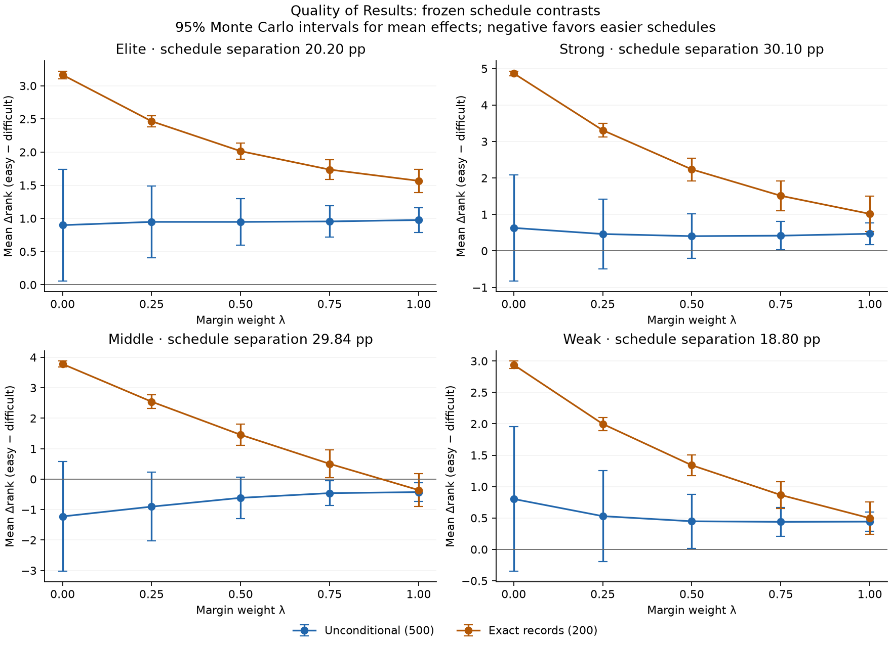

# Issue 261: Multi-strength Quality of Results schedule equivalence

## Decision from this study

The completed frozen experiment supports continuing to real-season validation, with λ=0.25 still a promising research candidate. No existing candidate shows a large, consistent easy-schedule reward across these four frozen comparisons. There are measurable small easy-schedule advantages for the middle profile at high margin weights, and the λ=0.25 middle estimate remains uncertain. These findings support further evaluation; they do not establish schedule equivalence, choose a final weight, or justify a production change.

## Unconditional findings: the primary scheduling evidence

At λ=0.25, mean Δrank and pointwise 95% Monte Carlo intervals are +0.95 [+0.41, +1.49] for elite, +0.46 [−0.49, +1.42] for strong, −0.90 [−2.03, +0.23] for middle, and +0.53 [−0.20, +1.26] for weak. Thus elite teams show a detectable difficult-schedule preference; strong and weak means also point in that direction but remain uncertain; the middle mean points toward an easier-schedule advantage but remains uncertain. In particular, the middle interval still permits an average easy advantage of about two rank places. Its inclusion of zero must not be described as equivalence or as ruling out effects that could matter in practice.

The easy team outranks the difficult team in 32.0%, 37.4%, 48.2% and 36.8% of unconditional λ=0.25 comparisons. Expected-rank mean effects and these probabilities measure different features of the trial distribution: the middle mean is negative even though its easy arm wins fewer than half the comparisons, because the sizes of the differences matter. Individual paired rank-difference SDs are 6.14, 10.90, 12.88 and 8.28, with broad p05–p95 intervals shown below. An individual team can benefit substantially from an easy slate even where the average contrast favors a difficult one.

All five elite unconditional means favor the difficult schedule by roughly 0.9–1.0 ranks. Strong means are positive but have zero-spanning intervals through λ=0.50; weak means are positive, with intervals excluding zero from λ=0.50 upward. Middle means are negative at every weight; λ=0.75 and λ=1 have pointwise intervals excluding zero, with mean easy-schedule advantages of 0.46 and 0.43 ranks. Those are detectable nonzero model effects, not a claim of universal bias or evidence of practical equivalence. Their magnitude is small beside the observed outcome-driven spreads, but that alone cannot decide whether they matter in an actual ranking. There is no universal monotone unconditional response to increasing λ across all strengths, unlike the exact-record trend below.

Realized unconditional mean wins track the frozen expectations: difficult/easy means are 6.00/7.98, 5.04/8.00, 5.03/7.99 and 2.06/3.93. Each frozen expected win total lies within its corresponding per-arm 95% Monte Carlo interval. At λ=0.25, easier schedules have higher mean posterior rank SD, entropy and 80% width for elite, strong and middle profiles, and lower values for the weak profile. The weak changes are −1.09 rank SD, −0.19 entropy bits and −2.76 interval positions. Thus the weak-stratum uncertainty difference is present in both unconditional and exact-record populations.

## Exact-record findings

The exact-record panels answer a different question from choosing a schedule before outcomes are known. At λ=0.25, easy-minus-difficult mean expected-rank differences are +2.47 [2.38, 2.55] for elite, +3.31 [3.13, 3.49] for strong, +2.54 [2.32, 2.76] for middle, and +2.00 [1.89, 2.10] for weak teams. These pointwise 95% Monte Carlo intervals all favor the difficult schedule. The easy arm outranks the difficult arm in 0%, 0%, 4%, and 0.5% of these accepted comparisons respectively. Thus the frozen approximately-expected-record comparisons provide no evidence of an easy-schedule reward at λ=0.25. Their positive means are measured preferences for the difficult schedule, not evidence that the two schedules are equivalent.

Increasing λ reduces the mean difficult-schedule preference monotonically in every exact-record stratum. At λ=0, mean differences range from +2.94 to +4.87; at λ=1 they are +1.57 for elite, +1.02 for strong, −0.36 for middle, and +0.50 for weak. The middle λ=1 interval [−0.89, +0.17] leaves the mean direction uncertain. The endpoints give useful reference points, but a mean closer to zero is not by itself a better Quality of Results methodology.

The λ=0.25 conditional posterior rank SD is greater on the easy slate for elite, strong and middle teams (mean differences +2.08, +2.08 and +2.22 ranks), but lower for weak teams (−1.60). The issue 252 pattern of easier schedules having greater uncertainty therefore does not extend uniformly across strengths. The posterior-uncertainty and arm tables show entropy, central interval widths and full-PMF distances separately; neither a narrow mean-effect interval nor a small expected-rank difference implies that individual posteriors are precise or identical.

## How large are the effects relative to controls?

At λ=0.25, unconditional same-schedule control SDs are 11.85, 16.47, 19.07 and 14.86 ranks. Their means are near zero and their mean intervals span zero. The primary unconditional mean effects, all less than one rank in magnitude, are small beside those outcome-driven spreads. Primary-pair spreads are narrower than control spreads partly because primary margin draws are matched; this comparison is descriptive, not a decomposition of causal contributions.

Own-record-conditioned controls are much tighter: their λ=0.25 SDs are 1.42, 3.36, 4.11 and 4.37 ranks, and their mean intervals span zero. The +2.47 elite primary mean is large relative to its 1.42 control SD and exceeds the positive p95 control difference of +2.25. Strong, middle and weak primary means are around or below their corresponding control SDs. Therefore the conditional effects cannot all be dismissed as tiny relative to every relevant control baseline. In particular the elite conditional difficult-schedule preference is consistent, even though rewarding difficult schedules is not the primary objective. These are different selected populations, so no control statistic is subtracted from the primary effect.

At λ=0, own-record control SDs are only 0.28–0.48 ranks, compared with primary difficult-schedule mean advantages of 2.94–4.87. At λ=1, those control SDs rise to 3.98–12.24. Fixing records removes much of the binary-outcome variation, while margin-based candidates still distinguish margin realizations within the same records. This is another reason to evaluate winning and margin sensitivity together rather than selecting the smallest average schedule contrast.

Primary-seed controls remain a separate population: for example, the weak λ=0.25 control B-minus-A mean is −2.47 [−4.79, −0.16] despite identical schedules, whereas its own-record-conditioned control mean is −0.13 [−0.73, +0.48]. That isolated pointwise interval is not an easy-schedule effect. It illustrates why realized variation, finite Monte Carlo samples, population selection and multiple comparisons must be considered before attributing any observed contrast to schedule difficulty.

## Winning and candidate interpretation

Issue 252's retained outcome-sensitivity counterfactuals remain separate evidence; they were not rerun here. In its approximately-even case, λ=0.25 improves expected rank by 8.40 places when −3 becomes +3, compared with 1.69 when a +10 win becomes +35. Against its weaker opponent, the corresponding benefits are 5.44 and 1.73 places. At λ=1 those win/loss changes yield only 1.50 and 1.30 places, while the within-win margin changes yield 4.91 and 5.45. These are particular fixed counterfactuals, not universal exchange rates between points and victories. They explain why a schedule contrast nearest zero cannot be the sole candidate-selection criterion. They also leave the direct outcome-sensitivity evidence at the elite and weak extremes incomplete.

The conditional difficult-schedule preferences at λ=0.25 are compatible with the stated objective, which permits a modest natural preference for difficult schedules and primarily seeks to avoid rewarding easy ones. Calling a 2.0–3.3-place conditional preference acceptable for further research is a normative assessment, not an equivalence test or a new acceptance threshold. No final margin weight is selected or activated.

## Cross-stratum and external-validity limits

The actual easy-minus-difficult win-probability separations are 20.20, 30.10, 29.84 and 18.80 percentage points for elite, strong, middle and weak profiles. The corresponding priors have rank SDs 7.91, 18.33, 33.27 and 19.58, and their expected ranks lie near 6.46, 20.17, 64.95 and 120.05 on a bounded 1–138 support. Different schedules, PMF shapes, boundary constraints and conditioning targets accompany the different strengths. Larger absolute effects therefore do not establish greater intrinsic schedule sensitivity at one strength level. No new normalization is applied, and this design cannot isolate a strength-by-schedule causal mechanism. The Colorado reference from issue 252 has different focal and schedule distributions from the new middle stratum; differences between their conditional estimates are not a controlled change in strength alone.

Within a profile, the paired season distribution contains schedule differences, realized outcomes and margins, and inference responses. Controls supply additional evidence about outcome-driven variation on the difficult slate. They do not identify an additive schedule-bias component: primary arms share margin draws, control margins are independent, and own-record conditioning selects a different population from primary-pair conditioning. The latent-rank means in the arm table expose those selection differences. Unconditional profiles also reuse the frozen shared seed range and should not be treated as four independent replications or pooled without accounting for their dependence.

All confidence intervals are pointwise Monte Carlo intervals, without a family-wise multiplicity adjustment. An interval containing zero is not proof of equivalence; an interval excluding zero is not automatically a practically important violation. There is no frozen practical-equivalence margin, so none is fitted or invented. Individual-season variation, posterior uncertainty, the direction and size of mean effects, and the intended significance of winning must all inform judgment. An absolute rank place may matter differently near the top and bottom of the support.

This is a model-based robustness study using the same frozen V1 model for generation and inference. It tests internal scheduling behavior under that model, not robustness to a misspecified likelihood, changed priors, real season selection, or calibration against truth. The disconnected ten-game stars omit the rest of the opponents' games and the mutual evidence paths and cycles of real season networks. Those omissions and the four fixed focal distributions limit generalization. Historical polls or other ranking observations in subsequent validation should remain measurements with uncertainty, not unquestioned ground truth.

## Specific next research step

Proceed to a preregistered real-season validation study extending issue 242: retain the five existing candidates, V1 likelihood and fixed priors; evaluate the completed 2025 season and the available 2026 weekly checkpoints with actual opponent networks; and freeze an elite/strong/middle/weak case inventory before interpreting candidate rankings. Compare records, schedule difficulty, posterior uncertainty, winner-changing games and additional-margin performances, including elite and weak examples that were absent from issue 252's direct counterfactual evidence. Document where the modest simulated middle-profile easy advantages or weak-profile uncertainty reversal appear in real cases. Treat historical ranking observations as measurements and report disagreements without optimizing against them as ground truth.

This is a recommendation to test external validity, not to repair a demonstrated large scheduling failure or to activate λ=0.25. Its justification combines the unconditional scheduling results, the difficult-schedule preferences in approximately-expected-record comparisons, the control evidence, and the existing winner-versus-margin counterfactuals. No final candidate or corrective schedule adjustment is proposed in this ticket.


## Experimental contract and execution

The committed issue 258 contract was used without redesign: 2026 Context 1.4 focal and opponent PMFs on all 138 ranks, Historical Likelihood V1, the frozen ten-opponent slates, and four home/four away/two neutral venues. Colorado remains provenance for issue 252, not a fifth stratum. Each pair shares a sampled focal rank and opponent quantiles; primary arms share Student-t margin draws, and controls have independent margin draws. Wins are the unmodified margin signs. Every λ receives the same generated games. Opponents remain uncertain full-PMF variables in the disconnected inference forest. Synthetic points encode a signed continuous margin and are likelihood observations, not literal football scores.

| Profile | Focal team | Prior E[rank] | Prior SD | Difficult / easy p(win) | Separation (pp) | Conditioned records |
|---|---|---|---|---|---|---|
| elite | Oregon | 6.46 | 7.91 | 59.91% / 80.11% | 20.20 | 6–4 / 8–2 |
| strong | Oklahoma | 20.17 | 18.33 | 49.92% / 80.02% | 30.10 | 5–5 / 8–2 |
| middle | Western Michigan | 64.95 | 33.27 | 50.13% / 79.98% | 29.84 | 5–5 / 8–2 |
| weak | Sam Houston | 120.05 | 19.58 | 19.98% / 38.78% | 18.80 | 2–8 / 4–6 |

There are 500 unconditional, 200 primary-record-conditioned, and 200 independently own-record-conditioned control comparisons per stratum. Primary-conditioned seeds retain four arms; control-conditioned seeds infer only the two controls. Controls on primary-conditioned seeds are explicitly labeled `primary_seed_control`; they were not selected on their own records. All eight searches found 200 acceptances before the 20,000-attempt ceilings. Seed search used only records, before candidate ranks. All five existing candidates (0, 0.25, 0.5, 0.75, 1) were evaluated without schedule selection or parameter changes.

| Profile | Panel | Accepted | Attempts | Acceptance | Searched seeds (inclusive) |
|---|---|---|---|---|---|
| elite | unconditional | 500 | 500 | 100.000% | 2700000–2700499 |
| elite | primary_conditioned | 200 | 2551 | 7.840% | 2710000–2712550 |
| elite | control_conditioned | 200 | 4774 | 4.189% | 2810000–2814773 |
| strong | unconditional | 500 | 500 | 100.000% | 2700000–2700499 |
| strong | primary_conditioned | 200 | 4161 | 4.807% | 2730000–2734160 |
| strong | control_conditioned | 200 | 7084 | 2.823% | 2830000–2837083 |
| middle | unconditional | 500 | 500 | 100.000% | 2700000–2700499 |
| middle | primary_conditioned | 200 | 4385 | 4.561% | 2750000–2754384 |
| middle | control_conditioned | 200 | 6789 | 2.946% | 2850000–2856788 |
| weak | unconditional | 500 | 500 | 100.000% | 2700000–2700499 |
| weak | primary_conditioned | 200 | 3277 | 6.103% | 2770000–2773276 |
| weak | control_conditioned | 200 | 3399 | 5.884% | 2870000–2873398 |

Validation checked every frozen artifact, the manifest, design-code, protocol and documentation hashes; reconstructed all schedule probabilities to 1e-12; and smoke-tested all profiles and weights. All focal PMFs were finite, nonnegative, normalized on 138 ranks, and all runs converged using the existing deterministic BP defaults (500 iterations maximum, tolerance 1e-9, damping 0.35). Focal Context priors were stripped by the existing Performance implementation. The research harness clears the engine's unbounded factor cache between trials to bound memory; it does not alter factors or inference. Evidence hashes are identical across weights and rechecked against regenerated observations during aggregation.

The four-trial smoke benchmark estimated 62.8 serial inference minutes (the frozen planning estimate was 108). The sum of per-trial elapsed inference times was 122.8 minutes across concurrent processes. This includes scheduling and resource contention; it is neither CPU time nor study wall time. The environment followed the repository's `.python-version` pin: Python 3.13.15, NumPy 2.5.2, SciPy 1.18.1. NumPy and SciPy match the frozen design versions. No scientific deviations or execution limitations were needed.

## Paired schedule effects

Δrank = E[rank easy] − E[rank difficult]. Negative favors easier schedules. Intervals are normal 95% Monte Carlo confidence intervals for paired means; outrank intervals are Wilson 95% intervals for the fraction with strictly smaller easy-arm expected rank. They describe finite-simulation precision, not historical external validity. Individual-season p05/p95 and SD describe realized variation; posterior uncertainty below is a separate quantity. Quantiles use NumPy's default linear interpolation. The 100 rows in `simulation_summary.csv` retain additional quartiles and CIs for every uncertainty and distance metric.



### Unconditional populations (500 pairs per profile)

| Profile | Separation (pp) | λ | Mean Δ [95% MC CI] | Median Δ | SD(Δ) | p05 / p95 | P(easy outranks) [Wilson 95%] |
|---|---|---|---|---|---|---|---|
| elite | 20.20 | 0 | +0.90 [+0.05, +1.74] | +2.58 | 9.64 | -17.74 / +14.62 | 0.318 [0.279, 0.360] |
| elite | 20.20 | 0.25 | +0.95 [+0.41, +1.49] | +1.58 | 6.14 | -9.51 / +9.89 | 0.320 [0.281, 0.362] |
| elite | 20.20 | 0.5 | +0.95 [+0.60, +1.29] | +1.17 | 3.96 | -6.14 / +6.74 | 0.264 [0.227, 0.304] |
| elite | 20.20 | 0.75 | +0.95 [+0.72, +1.19] | +1.07 | 2.67 | -3.87 / +4.80 | 0.190 [0.158, 0.227] |
| elite | 20.20 | 1 | +0.98 [+0.79, +1.16] | +1.01 | 2.12 | -2.94 / +4.13 | 0.158 [0.129, 0.193] |
| strong | 30.10 | 0 | +0.63 [-0.83, +2.09] | +3.91 | 16.66 | -29.45 / +22.60 | 0.376 [0.335, 0.419] |
| strong | 30.10 | 0.25 | +0.46 [-0.49, +1.42] | +2.47 | 10.90 | -19.87 / +15.53 | 0.374 [0.333, 0.417] |
| strong | 30.10 | 0.5 | +0.40 [-0.20, +1.01] | +1.63 | 6.92 | -11.73 / +10.05 | 0.380 [0.339, 0.423] |
| strong | 30.10 | 0.75 | +0.42 [+0.03, +0.80] | +1.29 | 4.40 | -8.08 / +7.01 | 0.376 [0.335, 0.419] |
| strong | 30.10 | 1 | +0.47 [+0.18, +0.76] | +0.99 | 3.36 | -5.92 / +5.46 | 0.390 [0.348, 0.433] |
| middle | 29.84 | 0 | -1.23 [-3.02, +0.57] | +0.69 | 20.53 | -37.07 / +31.64 | 0.472 [0.429, 0.516] |
| middle | 29.84 | 0.25 | -0.90 [-2.03, +0.23] | +0.56 | 12.88 | -23.85 / +19.28 | 0.482 [0.439, 0.526] |
| middle | 29.84 | 0.5 | -0.61 [-1.29, +0.07] | +0.38 | 7.75 | -13.87 / +11.12 | 0.472 [0.429, 0.516] |
| middle | 29.84 | 0.75 | -0.46 [-0.86, -0.06] | +0.05 | 4.62 | -8.19 / +6.50 | 0.496 [0.452, 0.540] |
| middle | 29.84 | 1 | -0.43 [-0.74, -0.12] | -0.47 | 3.53 | -6.24 / +5.63 | 0.568 [0.524, 0.611] |
| weak | 18.80 | 0 | +0.80 [-0.35, +1.95] | +3.07 | 13.13 | -21.76 / +18.51 | 0.374 [0.333, 0.417] |
| weak | 18.80 | 0.25 | +0.53 [-0.20, +1.26] | +2.02 | 8.28 | -13.47 / +12.04 | 0.368 [0.327, 0.411] |
| weak | 18.80 | 0.5 | +0.45 [+0.02, +0.88] | +1.17 | 4.89 | -8.57 / +7.21 | 0.366 [0.325, 0.409] |
| weak | 18.80 | 0.75 | +0.44 [+0.21, +0.67] | +0.76 | 2.65 | -4.66 / +4.37 | 0.370 [0.329, 0.413] |
| weak | 18.80 | 1 | +0.44 [+0.29, +0.59] | +0.59 | 1.72 | -2.58 / +3.04 | 0.338 [0.298, 0.381] |

### Exact-record primary populations (200 accepted pairs per profile)

| Profile | Separation (pp) | λ | Mean Δ [95% MC CI] | Median Δ | SD(Δ) | p05 / p95 | P(easy outranks) [Wilson 95%] |
|---|---|---|---|---|---|---|---|
| elite | 20.20 | 0 | +3.16 [+3.11, +3.22] | +3.17 | 0.41 | +2.52 / +3.95 | 0.000 [0.000, 0.019] |
| elite | 20.20 | 0.25 | +2.47 [+2.38, +2.55] | +2.50 | 0.59 | +1.57 / +3.42 | 0.000 [0.000, 0.019] |
| elite | 20.20 | 0.5 | +2.01 [+1.90, +2.13] | +1.98 | 0.86 | +0.67 / +3.41 | 0.005 [0.001, 0.028] |
| elite | 20.20 | 0.75 | +1.74 [+1.59, +1.89] | +1.72 | 1.07 | +0.19 / +3.55 | 0.030 [0.014, 0.064] |
| elite | 20.20 | 1 | +1.57 [+1.39, +1.74] | +1.56 | 1.26 | -0.23 / +3.69 | 0.075 [0.046, 0.120] |
| strong | 30.10 | 0 | +4.87 [+4.81, +4.93] | +4.90 | 0.45 | +4.00 / +5.56 | 0.000 [0.000, 0.019] |
| strong | 30.10 | 0.25 | +3.31 [+3.13, +3.49] | +3.16 | 1.33 | +1.32 / +5.63 | 0.000 [0.000, 0.019] |
| strong | 30.10 | 0.5 | +2.24 [+1.92, +2.55] | +2.05 | 2.26 | -1.09 / +6.10 | 0.175 [0.129, 0.234] |
| strong | 30.10 | 0.75 | +1.51 [+1.10, +1.92] | +1.22 | 2.95 | -3.02 / +6.48 | 0.325 [0.264, 0.393] |
| strong | 30.10 | 1 | +1.02 [+0.53, +1.50] | +0.66 | 3.48 | -4.42 / +6.84 | 0.425 [0.359, 0.494] |
| middle | 29.84 | 0 | +3.78 [+3.69, +3.87] | +3.74 | 0.68 | +2.73 / +4.83 | 0.000 [0.000, 0.019] |
| middle | 29.84 | 0.25 | +2.54 [+2.32, +2.76] | +2.36 | 1.59 | +0.13 / +4.96 | 0.040 [0.020, 0.077] |
| middle | 29.84 | 0.5 | +1.46 [+1.10, +1.81] | +1.07 | 2.55 | -2.41 / +5.46 | 0.300 [0.241, 0.367] |
| middle | 29.84 | 0.75 | +0.50 [+0.05, +0.96] | +0.03 | 3.28 | -4.42 / +5.50 | 0.495 [0.426, 0.564] |
| middle | 29.84 | 1 | -0.36 [-0.89, +0.17] | -0.83 | 3.85 | -5.93 / +5.81 | 0.555 [0.486, 0.622] |
| weak | 18.80 | 0 | +2.94 [+2.88, +3.00] | +2.93 | 0.42 | +2.28 / +3.65 | 0.000 [0.000, 0.019] |
| weak | 18.80 | 0.25 | +2.00 [+1.89, +2.10] | +1.88 | 0.76 | +0.81 / +3.33 | 0.005 [0.001, 0.028] |
| weak | 18.80 | 0.5 | +1.34 [+1.17, +1.51] | +1.19 | 1.20 | -0.57 / +3.57 | 0.120 [0.082, 0.172] |
| weak | 18.80 | 0.75 | +0.87 [+0.65, +1.08] | +0.78 | 1.55 | -1.52 / +3.79 | 0.290 [0.232, 0.356] |
| weak | 18.80 | 1 | +0.50 [+0.24, +0.75] | +0.46 | 1.85 | -2.58 / +3.86 | 0.390 [0.325, 0.459] |

### Candidate differences on the same evidence

These are within-seed changes in the schedule effect between candidates, with paired 95% Monte Carlo intervals. A positive change shifts the easy-minus-difficult effect toward the difficult schedule; it does not by itself imply an overall difficult-schedule advantage. All ten candidate pairs, including controls, are retained in `candidate_contrasts.csv`. These comparisons do not define a candidate-selection objective or an equivalence threshold.

| Profile | Panel | Change in Δ: λ=0 → 0.25 [CI] | Change in Δ: λ=0.25 → 1 [CI] |
|---|---|---|---|
| elite | unconditional | +0.05 [-0.27, +0.37] | +0.03 [-0.44, +0.50] |
| elite | primary_conditioned | -0.70 [-0.77, -0.63] | -0.90 [-1.01, -0.79] |
| strong | unconditional | -0.17 [-0.69, +0.35] | +0.01 [-0.86, +0.87] |
| strong | primary_conditioned | -1.56 [-1.74, -1.38] | -2.29 [-2.61, -1.98] |
| middle | unconditional | +0.32 [-0.37, +1.02] | +0.48 [-0.60, +1.55] |
| middle | primary_conditioned | -1.24 [-1.45, -1.02] | -2.90 [-3.25, -2.56] |
| weak | unconditional | -0.27 [-0.71, +0.16] | -0.09 [-0.79, +0.61] |
| weak | primary_conditioned | -0.94 [-1.04, -0.84] | -1.50 [-1.68, -1.32] |

## Same-schedule outcome variation

Control Δ is E[rank B] − E[rank A], with both controls on the difficult slate. B is not an easier-schedule arm. All three control populations are shown separately. They are baselines alongside the schedule contrasts, not bias estimates subtracted from them. Primary arms share margin shocks, while control margins are independent; the spread difference between primary and control pairs therefore is not a clean decomposition of variance into schedule and outcome terms. Controls share latent focal and opponent draws, so this baseline is also conditional on that matching structure.

| Profile | λ | Unconditional mean Δ [CI] | SD | p05 / p95 | Primary-seed mean Δ [CI] | SD | p05 / p95 | Own-record mean Δ [CI] | SD | p05 / p95 |
|---|---|---|---|---|---|---|---|---|---|---|
| elite | 0 | -0.00 [-1.33, +1.33] | 15.22 | -21.58 / +28.23 | +0.10 [-1.77, +1.96] | 13.45 | -20.11 / +16.12 | -0.03 [-0.07, +0.01] | 0.28 | -0.44 / +0.44 |
| elite | 0.25 | -0.16 [-1.20, +0.88] | 11.85 | -17.80 / +19.26 | +0.12 [-1.37, +1.61] | 10.74 | -17.98 / +12.06 | -0.13 [-0.33, +0.07] | 1.42 | -2.40 / +2.25 |
| elite | 0.5 | -0.27 [-1.18, +0.63] | 10.30 | -17.28 / +15.91 | +0.16 [-1.13, +1.45] | 9.32 | -15.67 / +11.79 | -0.21 [-0.55, +0.13] | 2.43 | -4.36 / +3.92 |
| elite | 0.75 | -0.36 [-1.20, +0.49] | 9.63 | -15.53 / +13.64 | +0.20 [-0.98, +1.39] | 8.55 | -12.98 / +11.14 | -0.27 [-0.73, +0.18] | 3.27 | -5.91 / +5.00 |
| elite | 1 | -0.42 [-1.25, +0.40] | 9.40 | -15.46 / +13.38 | +0.25 [-0.88, +1.38] | 8.14 | -11.34 / +11.53 | -0.33 [-0.88, +0.23] | 3.98 | -6.85 / +5.99 |
| strong | 0 | +0.63 [-1.09, +2.35] | 19.63 | -36.73 / +35.24 | -1.39 [-4.22, +1.44] | 20.41 | -38.33 / +31.79 | +0.02 [-0.02, +0.06] | 0.31 | -0.52 / +0.52 |
| strong | 0.25 | +0.18 [-1.26, +1.63] | 16.47 | -29.42 / +26.93 | -1.18 [-3.53, +1.17] | 16.95 | -29.36 / +28.10 | -0.13 [-0.60, +0.33] | 3.36 | -6.35 / +5.21 |
| strong | 0.5 | -0.14 [-1.46, +1.19] | 15.14 | -26.96 / +25.17 | -1.05 [-3.15, +1.05] | 15.17 | -26.07 / +23.64 | -0.28 [-1.10, +0.54] | 5.90 | -11.37 / +8.63 |
| strong | 0.75 | -0.38 [-1.67, +0.91] | 14.71 | -25.87 / +22.61 | -0.96 [-2.93, +1.02] | 14.27 | -24.28 / +20.56 | -0.41 [-1.50, +0.67] | 7.80 | -14.83 / +11.98 |
| strong | 1 | -0.58 [-1.87, +0.70] | 14.71 | -24.37 / +22.23 | -0.88 [-2.80, +1.04] | 13.86 | -22.82 / +21.43 | -0.53 [-1.81, +0.76] | 9.24 | -17.42 / +13.81 |
| middle | 0 | +0.56 [-1.31, +2.43] | 21.37 | -38.17 / +37.72 | +2.45 [-1.05, +5.95] | 25.25 | -38.45 / +40.14 | -0.01 [-0.08, +0.05] | 0.48 | -0.82 / +0.79 |
| middle | 0.25 | +0.18 [-1.49, +1.85] | 19.07 | -32.13 / +30.76 | +1.71 [-1.40, +4.82] | 22.46 | -31.59 / +37.66 | +0.23 [-0.34, +0.80] | 4.11 | -6.17 / +6.87 |
| middle | 0.5 | -0.13 [-1.71, +1.45] | 18.03 | -30.90 / +27.59 | +1.14 [-1.79, +4.06] | 21.11 | -28.64 / +33.77 | +0.41 [-0.62, +1.43] | 7.40 | -11.07 / +12.60 |
| middle | 0.75 | -0.38 [-1.93, +1.18] | 17.75 | -30.87 / +26.96 | +0.69 [-2.18, +3.55] | 20.68 | -29.53 / +32.44 | +0.54 [-0.85, +1.94] | 10.06 | -15.51 / +17.09 |
| middle | 1 | -0.57 [-2.14, +1.00] | 17.87 | -31.03 / +27.59 | +0.32 [-2.55, +3.20] | 20.76 | -35.82 / +32.53 | +0.65 [-1.05, +2.34] | 12.24 | -18.72 / +20.69 |
| weak | 0 | +0.17 [-1.33, +1.66] | 17.02 | -29.35 / +26.19 | -2.56 [-5.20, +0.08] | 19.06 | -37.58 / +26.06 | -0.03 [-0.08, +0.02] | 0.39 | -0.74 / +0.55 |
| weak | 0.25 | +0.01 [-1.29, +1.32] | 14.86 | -26.69 / +25.10 | -2.47 [-4.79, -0.16] | 16.69 | -30.71 / +25.28 | -0.13 [-0.73, +0.48] | 4.37 | -7.12 / +6.38 |
| weak | 0.5 | -0.10 [-1.31, +1.11] | 13.80 | -24.01 / +24.45 | -2.36 [-4.51, -0.22] | 15.47 | -26.01 / +23.60 | -0.17 [-1.18, +0.84] | 7.29 | -12.01 / +10.69 |
| weak | 0.75 | -0.18 [-1.36, +0.99] | 13.39 | -22.94 / +23.52 | -2.25 [-4.33, -0.18] | 14.96 | -25.73 / +23.45 | -0.18 [-1.47, +1.11] | 9.30 | -15.27 / +13.85 |
| weak | 1 | -0.25 [-1.42, +0.92] | 13.33 | -23.37 / +23.38 | -2.16 [-4.22, -0.11] | 14.84 | -25.74 / +23.17 | -0.17 [-1.66, +1.32] | 10.75 | -17.85 / +16.11 |

Control medians, quartiles, outrank probabilities/Wilson intervals, TV/Wasserstein distances and paired uncertainty CIs are in the machine-readable summary alongside every primary comparison.

## Posterior uncertainty and realized outcomes

The next table reports easy minus difficult mean posterior SD, entropy in bits, and central 80% width, with 95% Monte Carlo intervals. Width is the inclusive number of rank positions between the 10th and 90th percentile ranks. TV is half the L1 PMF distance; W1 is the sum of absolute CDF differences over unit-spaced ranks. Distance means compare entire paired PMFs and need not vanish when expected ranks are close.

| Profile | Panel | λ | Δ rank SD [CI] | Δ entropy bits [CI] | Δ 80% width [CI] | Mean TV | Mean W1 (ranks) |
|---|---|---|---|---|---|---|---|
| elite | unconditional | 0 | +0.95 [+0.58, +1.32] | +0.29 [+0.23, +0.35] | +2.20 [+1.22, +3.19] | 0.240 | 6.69 |
| elite | unconditional | 0.25 | +0.96 [+0.71, +1.21] | +0.27 [+0.22, +0.31] | +2.45 [+1.80, +3.11] | 0.183 | 4.37 |
| elite | unconditional | 0.5 | +0.96 [+0.80, +1.12] | +0.25 [+0.22, +0.28] | +2.43 [+2.00, +2.86] | 0.140 | 2.93 |
| elite | unconditional | 0.75 | +0.95 [+0.84, +1.06] | +0.25 [+0.23, +0.27] | +2.40 [+2.10, +2.70] | 0.112 | 2.12 |
| elite | unconditional | 1 | +0.94 [+0.85, +1.03] | +0.25 [+0.23, +0.26] | +2.34 [+2.10, +2.58] | 0.102 | 1.79 |
| elite | primary_conditioned | 0 | +2.40 [+2.37, +2.43] | +0.41 [+0.40, +0.41] | +6.64 [+6.53, +6.76] | 0.137 | 3.16 |
| elite | primary_conditioned | 0.25 | +2.08 [+2.03, +2.12] | +0.37 [+0.36, +0.38] | +5.61 [+5.46, +5.75] | 0.118 | 2.47 |
| elite | primary_conditioned | 0.5 | +1.78 [+1.72, +1.85] | +0.33 [+0.32, +0.35] | +4.62 [+4.41, +4.83] | 0.108 | 2.03 |
| elite | primary_conditioned | 0.75 | +1.56 [+1.48, +1.64] | +0.31 [+0.29, +0.33] | +3.82 [+3.57, +4.07] | 0.105 | 1.81 |
| elite | primary_conditioned | 1 | +1.40 [+1.31, +1.49] | +0.30 [+0.28, +0.32] | +3.54 [+3.28, +3.79] | 0.108 | 1.72 |
| strong | unconditional | 0 | +1.41 [+0.95, +1.86] | +0.26 [+0.20, +0.33] | +3.47 [+2.20, +4.75] | 0.311 | 12.80 |
| strong | unconditional | 0.25 | +1.22 [+0.91, +1.53] | +0.23 [+0.19, +0.28] | +3.12 [+2.27, +3.97] | 0.234 | 8.38 |
| strong | unconditional | 0.5 | +1.09 [+0.88, +1.30] | +0.22 [+0.18, +0.25] | +2.86 [+2.29, +3.42] | 0.173 | 5.38 |
| strong | unconditional | 0.75 | +1.00 [+0.85, +1.14] | +0.21 [+0.18, +0.23] | +2.68 [+2.28, +3.09] | 0.133 | 3.56 |
| strong | unconditional | 1 | +0.93 [+0.81, +1.05] | +0.20 [+0.18, +0.22] | +2.53 [+2.19, +2.87] | 0.117 | 2.83 |
| strong | primary_conditioned | 0 | +2.66 [+2.62, +2.69] | +0.29 [+0.29, +0.29] | +8.01 [+7.86, +8.16] | 0.141 | 4.94 |
| strong | primary_conditioned | 0.25 | +2.08 [+2.01, +2.15] | +0.24 [+0.24, +0.25] | +6.21 [+6.00, +6.43] | 0.120 | 3.51 |
| strong | primary_conditioned | 0.5 | +1.62 [+1.50, +1.73] | +0.21 [+0.20, +0.23] | +4.97 [+4.62, +5.32] | 0.111 | 2.80 |
| strong | primary_conditioned | 0.75 | +1.28 [+1.14, +1.43] | +0.19 [+0.17, +0.21] | +3.97 [+3.54, +4.40] | 0.114 | 2.81 |
| strong | primary_conditioned | 1 | +1.05 [+0.89, +1.22] | +0.17 [+0.15, +0.20] | +3.36 [+2.86, +3.86] | 0.123 | 3.03 |
| middle | unconditional | 0 | +3.11 [+2.73, +3.49] | +0.18 [+0.14, +0.23] | +8.84 [+7.71, +9.96] | 0.306 | 16.53 |
| middle | unconditional | 0.25 | +2.21 [+1.96, +2.46] | +0.15 [+0.12, +0.18] | +6.06 [+5.35, +6.77] | 0.217 | 10.42 |
| middle | unconditional | 0.5 | +1.47 [+1.31, +1.63] | +0.11 [+0.10, +0.13] | +4.00 [+3.54, +4.47] | 0.148 | 6.35 |
| middle | unconditional | 0.75 | +0.95 [+0.84, +1.06] | +0.08 [+0.07, +0.10] | +2.57 [+2.26, +2.88] | 0.100 | 3.88 |
| middle | unconditional | 1 | +0.59 [+0.50, +0.67] | +0.06 [+0.05, +0.07] | +1.56 [+1.31, +1.81] | 0.082 | 2.95 |
| middle | primary_conditioned | 0 | +3.13 [+3.11, +3.15] | +0.17 [+0.17, +0.17] | +8.74 [+8.65, +8.83] | 0.110 | 4.71 |
| middle | primary_conditioned | 0.25 | +2.22 [+2.17, +2.28] | +0.13 [+0.13, +0.14] | +6.04 [+5.84, +6.23] | 0.082 | 3.40 |
| middle | primary_conditioned | 0.5 | +1.53 [+1.45, +1.60] | +0.10 [+0.09, +0.10] | +4.19 [+3.97, +4.41] | 0.064 | 2.75 |
| middle | primary_conditioned | 0.75 | +1.00 [+0.92, +1.07] | +0.07 [+0.06, +0.08] | +2.62 [+2.40, +2.85] | 0.061 | 2.81 |
| middle | primary_conditioned | 1 | +0.60 [+0.53, +0.67] | +0.04 [+0.04, +0.05] | +1.56 [+1.34, +1.78] | 0.069 | 3.21 |
| weak | unconditional | 0 | -1.50 [-1.84, -1.15] | -0.23 [-0.28, -0.18] | -3.77 [-4.73, -2.82] | 0.254 | 9.89 |
| weak | unconditional | 0.25 | -1.09 [-1.31, -0.87] | -0.19 [-0.22, -0.15] | -2.76 [-3.36, -2.15] | 0.182 | 6.26 |
| weak | unconditional | 0.5 | -0.82 [-0.96, -0.68] | -0.15 [-0.17, -0.13] | -2.08 [-2.45, -1.71] | 0.123 | 3.75 |
| weak | unconditional | 0.75 | -0.64 [-0.73, -0.56] | -0.12 [-0.14, -0.11] | -1.64 [-1.86, -1.41] | 0.080 | 2.12 |
| weak | unconditional | 1 | -0.52 [-0.58, -0.46] | -0.10 [-0.11, -0.09] | -1.36 [-1.52, -1.20] | 0.060 | 1.43 |
| weak | primary_conditioned | 0 | -2.17 [-2.19, -2.15] | -0.20 [-0.20, -0.20] | -6.26 [-6.36, -6.17] | 0.087 | 3.02 |
| weak | primary_conditioned | 0.25 | -1.60 [-1.64, -1.57] | -0.16 [-0.17, -0.16] | -4.45 [-4.57, -4.32] | 0.071 | 2.14 |
| weak | primary_conditioned | 0.5 | -1.16 [-1.22, -1.10] | -0.13 [-0.14, -0.12] | -3.29 [-3.47, -3.10] | 0.061 | 1.63 |
| weak | primary_conditioned | 0.75 | -0.83 [-0.90, -0.75] | -0.10 [-0.11, -0.09] | -2.32 [-2.54, -2.10] | 0.059 | 1.51 |
| weak | primary_conditioned | 1 | -0.59 [-0.67, -0.50] | -0.08 [-0.10, -0.07] | -1.70 [-1.96, -1.43] | 0.062 | 1.59 |

The following arm summaries expose absolute posterior uncertainty, latent-rank selection, records and margins at λ=0.25. All five weights and all arm/population combinations, record-frequency distributions, and per-arm quantiles/CIs are in `arm_summary.csv`; game-level observations and per-trial summaries are retained separately.

| Profile | Panel | Arm | Mean latent rank | Mean wins | Wins p05 / p95 | Mean margin | Mean E[rank] | Mean rank SD | Mean entropy bits | Mean 80% width |
|---|---|---|---|---|---|---|---|---|---|---|
| elite | unconditional | difficult | 6.30 | 6.00 | 2 / 9 | +4.15 | 14.28 | 8.99 | 4.58 | 22.15 |
| elite | unconditional | easy | 6.30 | 7.98 | 5 / 10 | +14.02 | 15.23 | 9.95 | 4.85 | 24.60 |
| elite | unconditional | control A | 6.30 | 5.92 | 2 / 9 | +4.10 | 14.25 | 9.04 | 4.61 | 22.31 |
| elite | unconditional | control B | 6.30 | 5.95 | 2 / 9 | +4.33 | 14.08 | 8.94 | 4.59 | 22.07 |
| elite | primary_conditioned | difficult | 4.54 | 6.00 | 6 / 6 | +4.84 | 9.80 | 7.53 | 4.57 | 17.43 |
| elite | primary_conditioned | easy | 4.54 | 8.00 | 8 / 8 | +14.54 | 12.27 | 9.60 | 4.93 | 23.03 |
| elite | primary_conditioned | control A | 4.54 | 6.29 | 3 / 9 | +5.33 | 11.24 | 7.82 | 4.44 | 19.07 |
| elite | primary_conditioned | control B | 4.54 | 6.28 | 4 / 9 | +5.24 | 11.36 | 7.84 | 4.44 | 19.05 |
| elite | control_conditioned | control A | 4.52 | 6.00 | 6 / 6 | +4.42 | 9.93 | 7.62 | 4.58 | 17.56 |
| elite | control_conditioned | control B | 4.52 | 6.00 | 6 / 6 | +4.63 | 9.80 | 7.52 | 4.56 | 17.36 |
| strong | unconditional | difficult | 19.79 | 5.04 | 1 / 9 | +0.01 | 29.35 | 14.22 | 5.45 | 36.58 |
| strong | unconditional | easy | 19.79 | 8.00 | 5 / 10 | +15.00 | 29.81 | 15.44 | 5.69 | 39.70 |
| strong | unconditional | control A | 19.79 | 5.04 | 1 / 8.05 | -0.04 | 29.03 | 14.17 | 5.46 | 36.41 |
| strong | unconditional | control B | 19.79 | 4.98 | 1 / 8 | +0.20 | 29.21 | 14.22 | 5.47 | 36.49 |
| strong | primary_conditioned | difficult | 17.16 | 5.00 | 5 / 5 | -0.05 | 24.12 | 14.74 | 5.72 | 37.34 |
| strong | primary_conditioned | easy | 17.16 | 8.00 | 8 / 8 | +15.28 | 27.43 | 16.82 | 5.96 | 43.55 |
| strong | primary_conditioned | control A | 17.16 | 5.00 | 2 / 8 | +0.24 | 27.19 | 14.33 | 5.54 | 36.58 |
| strong | primary_conditioned | control B | 17.16 | 5.06 | 2 / 8 | +0.63 | 26.01 | 14.09 | 5.52 | 35.88 |
| strong | control_conditioned | control A | 16.73 | 5.00 | 5 / 5 | +0.08 | 23.94 | 14.66 | 5.71 | 37.15 |
| strong | control_conditioned | control B | 16.73 | 5.00 | 5 / 5 | +0.27 | 23.81 | 14.58 | 5.70 | 36.88 |
| middle | unconditional | difficult | 63.81 | 5.03 | 1 / 9 | +0.24 | 65.78 | 18.80 | 6.14 | 49.72 |
| middle | unconditional | easy | 63.81 | 7.99 | 4 / 10 | +15.46 | 64.87 | 21.01 | 6.29 | 55.77 |
| middle | unconditional | control A | 63.81 | 5.10 | 1 / 9 | +0.19 | 65.10 | 18.84 | 6.15 | 49.83 |
| middle | unconditional | control B | 63.81 | 5.05 | 1 / 9 | +0.42 | 65.28 | 18.92 | 6.16 | 50.01 |
| middle | primary_conditioned | difficult | 64.24 | 5.00 | 5 / 5 | -0.22 | 65.74 | 21.67 | 6.47 | 58.52 |
| middle | primary_conditioned | easy | 64.24 | 8.00 | 8 / 8 | +15.32 | 68.28 | 23.89 | 6.60 | 64.55 |
| middle | primary_conditioned | control A | 64.24 | 5.04 | 2 / 8 | +0.02 | 65.43 | 20.66 | 6.37 | 55.35 |
| middle | primary_conditioned | control B | 64.24 | 4.86 | 2 / 7.05 | -0.08 | 67.14 | 20.52 | 6.36 | 54.84 |
| middle | control_conditioned | control A | 65.03 | 5.00 | 5 / 5 | +0.45 | 64.96 | 21.64 | 6.47 | 58.38 |
| middle | control_conditioned | control B | 65.03 | 5.00 | 5 / 5 | +0.28 | 65.20 | 21.61 | 6.46 | 58.30 |
| weak | unconditional | difficult | 118.71 | 2.06 | 0 / 6 | -15.08 | 109.98 | 14.51 | 5.59 | 37.23 |
| weak | unconditional | easy | 118.71 | 3.93 | 0 / 8.05 | -4.88 | 110.51 | 13.42 | 5.40 | 34.48 |
| weak | unconditional | control A | 118.71 | 2.02 | 0 / 5.05 | -15.13 | 110.31 | 14.57 | 5.59 | 37.38 |
| weak | unconditional | control B | 118.71 | 2.02 | 0 / 6 | -14.90 | 110.33 | 14.65 | 5.61 | 37.60 |
| weak | primary_conditioned | difficult | 123.17 | 2.00 | 2 / 2 | -14.93 | 113.21 | 15.86 | 5.88 | 40.73 |
| weak | primary_conditioned | easy | 123.17 | 4.00 | 4 / 4 | -4.60 | 115.21 | 14.25 | 5.71 | 36.28 |
| weak | primary_conditioned | control A | 123.17 | 1.77 | 0 / 4 | -16.21 | 114.13 | 14.49 | 5.61 | 37.04 |
| weak | primary_conditioned | control B | 123.17 | 2.00 | 0 / 5 | -15.18 | 111.65 | 15.08 | 5.69 | 38.73 |
| weak | control_conditioned | control A | 122.85 | 2.00 | 2 / 2 | -14.88 | 113.23 | 15.81 | 5.87 | 40.62 |
| weak | control_conditioned | control B | 122.85 | 2.00 | 2 / 2 | -14.92 | 113.10 | 15.85 | 5.87 | 40.76 |

## Reproduction and artifact inventory

Run from the repository root with its pinned environment. The profile commands can execute concurrently, each in a separate process with one BLAS thread. No research inference is added to ordinary CI; tests audit invariants and retained artifacts.

```bash
uv sync --locked
export OPENBLAS_NUM_THREADS=1 OMP_NUM_THREADS=1
uv run python scripts/run_issue_261_quality_of_results.py --smoke
uv run python scripts/run_issue_261_quality_of_results.py --profile elite
uv run python scripts/run_issue_261_quality_of_results.py --profile strong
uv run python scripts/run_issue_261_quality_of_results.py --profile middle
uv run python scripts/run_issue_261_quality_of_results.py --profile weak
uv run python scripts/run_issue_261_quality_of_results.py --aggregate
uv run python -m gippyrank.research.issue_261_report
```

`manifest.json` pins source revision and source hashes, existing input paths/hashes, all accepted seeds and attempted ranges, record criteria, inference settings, completed counts, smoke results and output hashes. It references the committed issue 258 input artifacts rather than duplicating them. `.checkpoints/` is an ignored, atomic per-trial cache; a changed execution fingerprint rejects reuse. A clean run regenerates it. Simulation wall timings may differ; the seeded evidence and numerical result tables are deterministic in the recorded environment. The report/figure can be refreshed from portable results without rerunning inference.

- `simulated_games.csv.gz`: all 128,000 game observations, latent rank draws, venues, source opponents, margins and wins.
- `team_trial_summaries.csv.gz`: all 64,000 arm/candidate rows with records, margins, full uncertainty summaries, convergence and evidence hashes.
- `pair_trial_summaries.csv.gz`: all 32,000 pair/candidate rows with rank effects, posterior uncertainty differences, TV and Wasserstein.
- `simulation_summary.csv`: 100 aggregate profile/panel/comparison/candidate rows.
- `arm_summary.csv`: all arm/candidate aggregates, outcome distributions and posterior uncertainty.
- `candidate_contrasts.csv`: 200 paired comparisons of candidate effects on identical trials.
- `schedule_effects.png`: static figure of primary mean effects and Monte Carlo intervals.
- `report.md`: this report, with methods and interpretation.

The legacy machine roles `approximately_even` and `weaker_opponents` mean the frozen difficult and easy arms respectively; they do not imply 50% win probabilities in every stratum. Full per-trial posterior PMFs are reproducible from the saved seed, games, frozen priors, likelihood and source; they are not duplicated in the output. No production ranking, predictive methodology, website or API changed.
