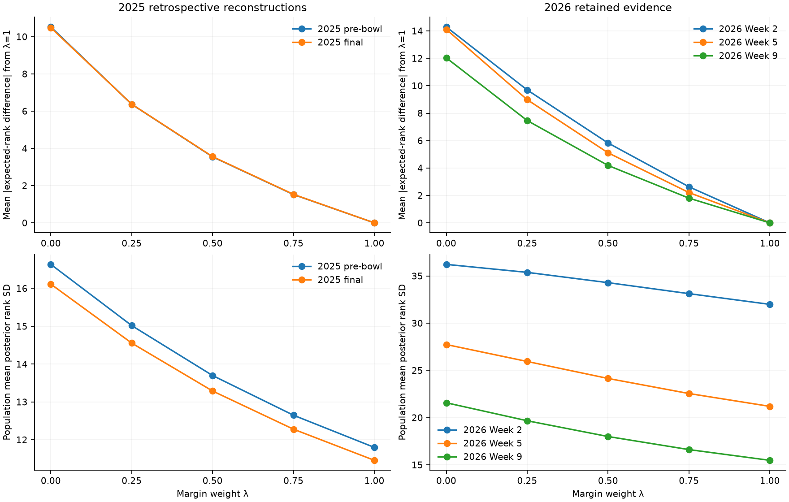
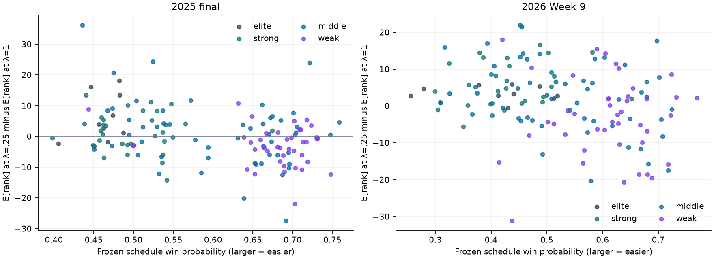

# Issue 265: real-season Quality of Results population findings

All **32 planned solves converged**, all ten endpoint comparisons passed, and all
three Week 9 input-order checks passed. The five candidates produce substantively
different evaluations, particularly for records supported by close results versus
strong margins. Intermediate weights retain meaningful differences from both
endpoints. This report **does not recommend a production weight** or establish
causal schedule bias. The already frozen case studies and game perturbations
remain unexecuted.

## Numerical evidence and scope

The read-only issue 263 verification passed before inference. Exact frozen inputs
were used for 2025 pre-bowl/final and 2026 Weeks 2/5/9: **1,570/1,625/171/530/975
games**, **136/136/138/138/138 FBS teams**, and **265/265/253/266/266 network
variables**. FCS variables, FCS–FCS games, legitimate rematches, V1 likelihood,
Context 1.2 (2025) and Context 1.4 (2026), prior stripping, and zero-game rules
were preserved. All FBS teams in these five populations have eligible evidence.
There were 25 baseline solves, four independent 2025 endpoint references using
the existing Record/margin implementations, and three reversed-order solves.

Cold-start BP used 500 maximum iterations, tolerance 1e-9 and damping .35 for
every cell. The execution took **456.0 seconds** including inference/checkpoint
IO, with **446.8 solve seconds**, a **45.91-second** slowest solve, and **1.10 GiB**
process high-water RSS. Iterations ranged from 25 to 132. No cell failed or used
relaxed settings. All complete-network and FBS PMFs were checked for finite,
nonnegative, normalized values. The three-hour, 600-second and 4-GiB ceilings were
not approached. Subsequent analysis reuses validated cells without inference.

Both reconstructed 2025 endpoints match their independently computed references
**exactly** in every PMF cell and expected rank. For 2026, the largest endpoint
PMF-cell difference is **1.67e-16**, and the largest expected-rank difference is
**5.68e-14**, far below 1e-8 and N×1e-8. All reversed-input PMFs match their
baseline **exactly**. No non-tied ordering disagreement occurs.

Week 2 Record has **45 numerical tie pairs among ten teams**: Maryland, Missouri,
Air Force, UCF, Louisiana Tech, Southern Miss, Tennessee, UTSA, Old Dominion and
UConn. Their pairwise expected-rank gaps are within the propagated 1.38e-6
numerical tolerance. The remaining endpoint/order gates have no numerical ties.
All pairs, gaps and thresholds are in [endpoint_parity.json](endpoint_parity.json).
These early tied display positions are not meaningful methodological differences.

The retained experiment contains **3,430 ranking rows**, **470,620 PMF cells**,
**50 candidate-pair summaries**, **6,860 team contrasts**, **6,650 accomplishment
panel rows**, **3,325 uncertainty panel rows**, **33,520 exact-record pair rows**,
**5,096 actual FBS game-perspective rows**, **1,830 boundary rows**, and **2,060
longitudinal team rows**. Full evidence and source/output hashes are in
[manifest.json](manifest.json); all solve diagnostics are in
[convergence.csv](convergence.csv).

## How different are the candidates?

Mean absolute expected-rank difference from Quality of Play (λ=1), in latent
rank coordinates; these are within-snapshot comparisons, not pooled estimates:

| Snapshot | λ=0 | λ=.25 | λ=.50 | λ=.75 | λ=1 |
| --- | ---: | ---: | ---: | ---: | ---: |
| 2025 pre-bowl | 10.524 | 6.370 | 3.547 | 1.523 | 0 |
| 2025 final | 10.484 | 6.374 | 3.558 | 1.532 | 0 |
| 2026 Week 2 | 14.291 | 9.696 | 5.826 | 2.632 | 0 |
| 2026 Week 5 | 14.111 | 8.987 | 5.110 | 2.211 | 0 |
| 2026 Week 9 | 12.036 | 7.465 | 4.188 | 1.803 | 0 |

The signed λ=1 minus λ=0 mean changes are −.316, −.274, −2.648, −3.013 and
−2.324 respectively. Their small magnitudes conceal substantial team movement:
these marginal rank coordinates need not sum to a permutation of team ranks.
The endpoint maximum absolute changes are 59.50 (Arkansas, 2025 pre-bowl),
58.85 (Arkansas, 2025 final), 33.24 (Buffalo, Week 2), 52.35 (Temple, Week 5),
and 50.27 (Stanford, Week 9).

| Snapshot | Endpoint ordering inversions | Endpoint top 10 / top 25 overlap | .25 vs 1 top 10 / top 25 overlap |
| --- | ---: | ---: | ---: |
| 2025 pre-bowl | 1,049 | 6 / 21 | 7 / 24 |
| 2025 final | 1,019 | 7 / 19 | 8 / 21 |
| 2026 Week 2 | 2,234 | 3 / 11 | 4 / 16 |
| 2026 Week 5 | 1,544 | 7 / 17 | 9 / 19 |
| 2026 Week 9 | 1,187 | 8 / 20 | 9 / 22 |

At Week 9, increasing .25→1 puts Utah into the top 10 and Kentucky out; Nebraska,
Oregon and Louisville enter the top 25 while Missouri, Iowa and Texas Tech exit.
At 2025 final the same comparison replaces Texas A&M/Alabama in the top 10 with
Vanderbilt/Utah. Complete named entries/exits and union movements for every pair
are retained in [population_contrasts.csv](population_contrasts.csv).

Intermediate candidates are not endpoint averages. At Week 9, .25 differs by
4.574 expected ranks on average from Record and 7.465 from Play. Its mean TV
from Play is .197 and mean rank-Wasserstein distance is 7.916. At 2025 final
those values are 4.131, 6.374, .220 and 6.730. These distribution changes are
large enough that an ordinal-only assessment would omit useful information.

Mean absolute adjacent steps (0→.25, .25→.5, .5→.75, .75→1) are respectively
4.574/3.279/2.388/1.803 at Week 9 and 4.131/2.819/2.028/1.532 at 2025 final.
The other snapshots also have progressively smaller average steps. This does
not make smoothness a weight-selection objective. There are **10/9/6/6/4** teams
with nonmonotonic expected-rank progressions across the five snapshots, above
numerical tolerance. For example, Week 9 Michigan improves in mean rank through
.75, then worsens by .024 at 1. No numerical instability accompanies these shifts.
[weight_sensitivity.csv](weight_sensitivity.csv) retains every adjacent slope and TV.

Small mean changes can coexist with conspicuous ordinal movement. Week 2
Washington moves **25 display places worse** from 0→1 although its expected rank
improves by **.147** and TV is only **.033**. At 2025 pre-bowl Nebraska moves four
places worse from .5→.75 with only **+.0035** expected-rank change and TV **.032**.
Conversely, a small mean change does not guarantee a nearly identical PMF:
2025 final Wisconsin moves seven display places from 0→.75 with +.141 mean
change but TV .128. Boundary gaps and latent top-10/12/25 probability-mass changes
are retained separately in [boundary_movement.csv](boundary_movement.csv).

## Accomplishments and schedule descriptions

Primary 2025 strata and schedule descriptors use **frozen preseason Context 1.2**;
primary 2026 strength bands use **retained QoP order** and schedule descriptions
integrate retained Context posteriors. In both cases the same full reference
team PMF is integrated against each opponent distribution at the actual venue:
Colorado (2025) or Western Michigan (2026). Smaller standardized win probability
means harder scheduling. Raw opponent records and simple mean opponent rank are
not primary schedule measures. The separately saved 2025 posterior-based
schedule descriptions do not redefine its primary strata or near-record groups.

For the contrast **λ=1 minus λ=.25**, a positive rank change means .25 evaluates
the team better. Whole-population Spearman descriptions are:

| Descriptor | 2025 final (n=136) | 2026 Week 9 (n=138) |
| --- | ---: | ---: |
| Win fraction | .222 | .107 |
| Standardized schedule probability (easier is larger) | .299 | .302 |
| Wins minus frozen-reference expectation | .376 | .631 |
| Average scoring margin | −.187 | −.341 |
| Close wins (1–7 points) | .678 | .549 |
| Close losses (1–7 points) | −.460 | −.374 |
| Dominant wins (at least 28 points) | −.375 | −.401 |

The strongest descriptions involve close outcomes and wins relative to
expectation, rather than win fraction alone. In the middle band (n=55), the
association with wins minus expectation is .405 in 2025 final and .818 in Week 9;
the corresponding schedule associations are .209 and .300. These are connected
observational populations, not independent samples or significance tests.
The full [association table](descriptive_associations.csv) includes all candidates,
snapshots, bands, denominators and undefined constant-column cases.

### Easier-schedule concerns and fixed-population comparisons

Lower margin weights are relatively more favorable to some easier schedules
(the positive schedule associations above), but the absolute rank gaps and
record-matched comparisons do not show a uniform easier-schedule reward.

For the **middle band**, easy-minus-hard group mean expected-rank gaps at
0/.25/.5/.75/1 are **19.05/23.74/26.65/28.58/29.94** at 2025 final and
**2.98/7.45/10.53/12.74/14.40** at Week 9. Positive means the easier group ranks
worse, despite higher group mean win fractions (.522 vs .419 in 2025; .661 vs
.449 in 2026). This is descriptive evidence of retained difficult-schedule credit;
it is not an estimate of the causal effect of choosing a schedule.

All exact-W–L pairs within each frozen strength band were retained. Middle-band
pairs at 2025 final (124 pairs) have mean easy-minus-hard gaps **18.59 at .25**
and **21.15 at 1**; at Week 9 (222 pairs), **13.82 and 13.37**. Easier teams rank
better in 12.1% and 9.0% of these .25 pairs respectively. The overlapping pairs
share teams and are not independent replications. Same-record comparisons still
do not control for all differences in team quality or accomplishment.

The **weak band warrants attention**: raw easy-minus-hard gaps favor easy teams
at .25 (−1.06 in 2025 final; −4.61 at Week 9), but easy-group win fractions are
higher (.506 vs .384; .478 vs .281). With exact records, the weak-band mean gaps
instead favor harder schedules: **+9.88** in 2025 (64 pairs) and **+6.04** in
2026 (79 pairs). Mixed results across these conditioning choices prevent a
single schedule-bias conclusion.

Near-expected-record uses the frozen |wins−expected wins|≤1 definition. At .25:

| Snapshot/reference | Band | Hard n / easy n | Easy-minus-hard mean expected rank |
| --- | --- | ---: | ---: |
| 2025 final / prior | elite | 2 / 0 | undefined (empty easy cell) |
| 2025 final / prior | strong | 2 / 4 | +26.12 |
| 2025 final / prior | middle | 4 / 7 | +26.03 |
| 2025 final / prior | weak | 4 / 2 | +27.17 |
| 2026 Week 9 / posterior | elite | 4 / 3 | +.34 |
| 2026 Week 9 / posterior | strong | 8 / 10 | +3.38 |
| 2026 Week 9 / posterior | middle | 17 / 17 | +7.47 |
| 2026 Week 9 / posterior | weak | 10 / 7 | −2.82 |

The Week 9 weak result reverses the difficult-schedule preference in the other
near-expectation bands. It persists at 1 (−4.93) and is smaller at 0 (−1.43).
This is an unresolved descriptive concern, not a warrant for a schedule bonus or
a preferred λ. The small 2025 cells especially limit interpretation. Complete
primary panel definitions, memberships and all candidate distributions are in
[accomplishment_panels.csv](accomplishment_panels.csv). There are **138/143/122/129/133**
distinct panels per snapshot, including **20/20/59/44/28 empty panels**. Empty
cells are retained, not replaced with more favorable cutpoints.

## Posterior uncertainty

Population mean rank SD, using the full marginal distributions:

| Snapshot | λ=0 | λ=.25 | λ=.50 | λ=.75 | λ=1 |
| --- | ---: | ---: | ---: | ---: | ---: |
| 2025 pre-bowl | 16.63 | 15.02 | 13.70 | 12.65 | 11.80 |
| 2025 final | 16.11 | 14.56 | 13.29 | 12.28 | 11.46 |
| 2026 Week 2 | 36.23 | 35.38 | 34.29 | 33.13 | 32.00 |
| 2026 Week 5 | 27.74 | 25.95 | 24.15 | 22.55 | 21.20 |
| 2026 Week 9 | 21.58 | 19.67 | 18.00 | 16.62 | 15.48 |

More margin weight narrows the population-average marginals in every snapshot.
At .25 the mean central 80% inclusive widths are **38.26** at 2025 final and
**97.06/68.83/51.54** at Weeks 2/5/9. Lower uncertainty is not by itself evidence
of greater correctness. The early snapshot is especially diffuse despite having
a full display order.

The weak-band uncertainty reversal from the synthetic study is not universal
here. At 2025 final, weak easy-minus-hard mean SD is **−.47 at .25**, changing to
**+.38 at 1**. At Week 9 it is **+.66 at .25** and **+.74 at 1**. The primary
historical and current strata have different meanings, and bounded rank support,
record mix and differing posterior locations affect these averages. Neither an
SD gap nor overlapping credible intervals establishes methodological equivalence.
All 50/80/95% widths, entropy, SD and distribution distances remain available per
team and panel. Numerical tolerance is unrelated to this model uncertainty.

## Evidence across the season

All five candidates receive each of the three frozen transitions. At .25:

| Transition | Added network games | Mean absolute E[rank] movement | Mean SD change | Top 10 / top 25 retained |
| --- | ---: | ---: | ---: | ---: |
| 2025 pre-bowl → final | 55 | 2.83 | −.46 | 9 / 22 |
| 2026 Week 2 → Week 5 | 359 | 18.71 | −9.44 | 4 / 13 |
| 2026 Week 5 → Week 9 | 445 | 11.71 | −6.28 | 7 / 16 |

The 2025 additions include 47 FBS–FBS and eight FCS–FCS games; source seasonType
labels are 50 postseason and five regular. This retains the later Army–Navy game
and FCS labeling distinctions instead of assuming every addition is an FBS bowl.
The 2026 additions are regular-labeled: 164 FBS–FBS / 68 cross-subdivision /
127 FCS–FCS, then 229 / six / 210. All earlier eligible IDs remain present.
There are no rated entrants or exits in these transitions.

These are changes in the entire opponent network. Per-team new own-game counts
are retained; a team's movement cannot be assigned only to its own new games.
The falling SD and top-set stabilization are consistent with deeper evidence,
but the snapshots are neither independent replications nor strictly prospective
backtests. See [longitudinal_summary.csv](longitudinal_summary.csv) for all 15
candidate/transition summaries and complete new-game identities.

## Interpretation limits and diagnostic handoff

Verified numerical findings: convergence, endpoint parity, order invariance,
complete distributions and deterministic table/figure regeneration pass. There
is no observed numerical instability. The descriptive results show meaningful
intermediate behavior, outcome-versus-margin disagreement, and strength/record-
dependent schedule and uncertainty patterns.

Plausible interpretation: reducing margin weight increases the credit given to
crossing the outcome boundary, especially in close games and in records above
reference expectation. This remains an interpretation of whole-network baseline
associations. It is not a measurement of counterfactual win/loss sensitivity.

Unresolved questions for the **already frozen** diagnostics:

- Explain large record/margin disagreements without treating individual results
  as additive contributions: the frozen Stanford case is particularly informative.
- Inspect the frozen middle identical-record schedule pair and the full middle
  population: difficult-schedule credit persists, but its relationship to λ
  changes across the conditioning choices and seasons.
- Investigate the weak near-expectation easier-group advantage at Week 9 and the
  inconsistent weak uncertainty reversal, using the frozen weak pair and probe.
- Use the frozen elite/weak four-state games to measure outcome-boundary versus
  within-win margin response directly; these baseline associations cannot do so.
- Use the frozen removals to inspect self-influence in retrospective Context
  expectations and the spread of effects through the full network.
- Interpret boundary entries/exits alongside adjacent gaps, PMF mass, SD and TV;
  arbitrary ordering of nearly equal means can produce large display movement.

The 2025 data are retrospective reconstructions with unknown original acquisition
availability, conservative kickoff lag, preseason priors and no independent
postseason roster/coaching model. The 2026 retained lineages include Context/DB
and Campbell repairs; exact prospective deployability is not established, and
Week 2's legacy FCS retrieval gap remains as frozen. Expected wins based on
cutoff Context posteriors reuse the games being described. FCS fallbacks, prior
misspecification, the V1 likelihood and loopy marginal approximation remain
limitations. Schedules are nonrandom and teams/candidates/snapshots dependent.
Human polls, selections, and predictive-rank agreement are not ground truth here.

Saved baseline/checkpoint infrastructure and all actual-game descriptions can be
reused as described in the [execution and handoff guide](../../../docs/issue_265_real_season_execution.md).
The frozen inventories remain unchanged. No detailed case-study results,
four-state experiments, game removals, new candidates, likelihood/prior refits,
production snapshots or publication files were created or modified.

## Exploratory population illustrations

These candidate-dependent examples illustrate the population contrasts. They
are not a selected confirmation sample, do not replace either frozen inventory,
and do not complete the follow-up case studies.

Illustrative population rows, **not completed frozen case studies**:

| Snapshot/team | Actual record | Primary schedule probability | E[rank] at .25 minus at 1 | Display rank .25 → 1 |
| --- | --- | ---: | ---: | --- |
| 2025 final Navy | 11–2 | .692 | −27.34 | 41 → 66 |
| 2025 final Arkansas | 2–10 | .435 | +36.15 | 81 → 46 |
| 2025 final Toledo | 8–5 | .721 | +23.95 | 65 → 42 |
| 2026 Week 9 Stanford | 4–4 | .438 | −31.06 | 88 → 116 |
| 2026 Week 9 UTSA | 7–1 | .579 | −20.37 | 34 → 65 |
| 2026 Week 9 TCU | 3–4 | .452 | +21.92 | 69 → 46 |

Navy's +6.46 average margin and Arkansas's −.92 illustrate why a record-focused
method can disagree sharply with a margin method. At Week 9 Stanford has a
−15.62 average margin but is +1.70 wins above retrospective Context expectation.
TCU has a +9.57 average margin but is −1.30 wins below expectation. These facts
make the direction of disagreement understandable; they do not validate either
endpoint or isolate a game's contribution. Actual opponents, sites, margins,
expected margins, integrated probabilities and opponent uncertainty are retained
in [actual_game_descriptors.csv.gz](actual_game_descriptors.csv.gz).
