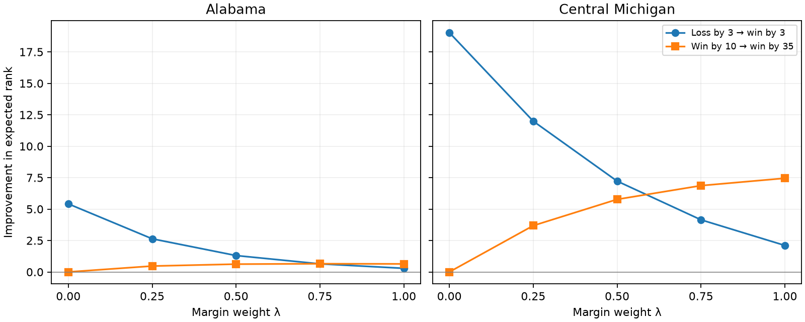

# Phase 4: real-season Quality of Results, cases and controlled evidence changes

The frozen experiment is complete: **40 score replacements and 25 game removals converged**, and all **27 team seasons / 70 snapshot-case observations** have been evaluated at all five weights. The 32 baseline/reference/order solves were verified and consumed without rerunning inference or rewriting their artifacts. The intermediate candidates retain opponent and margin information while making a narrow win materially more valuable than Quality of Play does. That supports the proposed family, but it does not establish schedule equivalence or uniquely identify a defensible weight.

The evidence is sufficient to proceed to a **separate methodology-selection discussion**, provided that discussion explicitly accepts the observed tradeoffs and the remaining schedule/uncertainty limits. This report does not select or activate a production methodology. No empirical schedule correction, new weight, refitted prior or likelihood, or production publication was introduced.

## Scope and evidence levels

The authoritative inputs are the [frozen issue 263 protocol](../../../docs/issue_263_real_season_protocol.md), its two case inventories, and the [completed issue 265 population study](../issue_265_real_seasons/report.md). The new diagnostics concern the entire frozen **2026 Week 9** network: **975 observations, 266 variables including FCS, and 138 FBS marginal distributions**. A removal leaves 974 observations. The 2025 pre-bowl/final and 2026 Weeks 2/5/9 cases use their original snapshot-specific priors and networks.

**Numerically established:** convergence and PMF validity, endpoint equality, four-state evidence responses, and single-observation removal responses. These are controlled changes to model evidence, not causal effects of real-world scheduling decisions.

**Descriptive:** actual records/margins, frozen opponent-aware reference expectations, real-season schedule associations, matched-record comparisons, boundary positions, and uncertainty patterns. Schedules, teams, snapshots and comparisons are dependent; selection emphasizes specific questions rather than representative sampling.

**Interpretation after observing results:** whether these tradeoffs satisfy the intended greater importance of winning while retaining margin/opponent information, and whether a later selection can be defended. Human polls, CFP selection and predictive-ranking agreement supply no ground-truth standard here.

## Numerical execution and provenance

All 65 diagnostics converged under deterministic cold-start BP: maximum 500 iterations, tolerance 1e-9, damping .35; original Context priors, Historical Likelihood V1, existing rematch factors and Performance prior stripping. There were no relaxed settings or failed cells. Iterations range **54–79**; largest terminal message delta **9.95e-10**. Inference/checkpoint execution took **321.5 seconds**, summed solve time **301.3 seconds**, slowest solve **18.14 seconds**; process high-water RSS **0.94 GiB**. RSS is a cumulative process maximum, not memory attributable to an individual game. The frozen three-hour, 600-second-per-solve and 4-GiB bounds were respected.

Every complete-network Context PMF and prior-stripped FBS PMF is retained and validated for population, support, finiteness, nonnegativity and normalization. Evidence counts and raw/grouped factor counts are checked against the exact perturbed network. All four λ=0 winning-margin comparisons pass: maximum FBS PMF difference **0**, maximum expected-rank difference **0**; the three artificial wins are identical within the frozen 1e-8/N×1e-8 tolerances. Full-network Context parity also passes.

Original baseline revision: `aba5f265a7bbca3bb3f6014d7c5500d1e9fdcd5a`; original fingerprint: `dc7ab5703b9a7d464c7782b4d0ab75d8167f9cedd7a03d533e6d21f50addc0fa`. New diagnostic execution revision: `f826e138e8ffc20c43cf7657827473172729231f`. Exact source/input/implementation fingerprints, original and replacement dated observations, team/game populations, numerical configuration and resource measurements accompany every checkpoint. The [manifest](manifest.json) hashes every retained output and records the original baseline verification identity. [Execution instructions](../../../docs/issue_267_real_season_diagnostics.md) describe deterministic replay and the separate analysis fingerprint.

## Controlled outcome-boundary versus within-win sensitivity

Each hypothetical score replaces one actual observation, retaining its ID, opponent, site, date and all other evidence. Opponent points are `max(actual_opponent_points,3)`, and focal points add the frozen hypothetical margin, then restore home/away orientation. These scenarios are evidence probes, not football predictions.

Positive benefits improve expected rank. Outcome benefit is `E[rank at −3] − E[rank at +3]`; margin benefit is `E[rank at +10] − E[rank at +35]`. The difference is outcome minus margin benefit. No ratio or universal points-per-win exchange rate is implied.

| Profile / focal team | λ | Outcome benefit | Within-win benefit | Difference | Ordinal outcome / margin benefit |
|---|---|---|---|---|---|
| elite / Alabama | 0 | 5.415 | 0.000 | +5.415 | 6 / 0 |
| elite / Alabama | 0.25 | 2.638 | 0.470 | +2.169 | 3 / 0 |
| elite / Alabama | 0.5 | 1.305 | 0.622 | +0.683 | 2 / 0 |
| elite / Alabama | 0.75 | 0.644 | 0.654 | -0.010 | 1 / 0 |
| elite / Alabama | 1 | 0.290 | 0.640 | -0.350 | 1 / 0 |
| weak / Central Michigan | 0 | 19.037 | 0.000 | +19.037 | 17 / 0 |
| weak / Central Michigan | 0.25 | 11.993 | 3.684 | +8.308 | 11 / 4 |
| weak / Central Michigan | 0.5 | 7.225 | 5.773 | +1.452 | 8 / 6 |
| weak / Central Michigan | 0.75 | 4.148 | 6.866 | -2.718 | 2 / 8 |
| weak / Central Michigan | 1 | 2.109 | 7.453 | -5.344 | 2 / 3 |

At λ=0 the response is entirely outcome based and within-win margin sensitivity vanishes. At .25 the additional outcome credit is substantial, while positive within-win sensitivity demonstrates that scoring margins remain informative. Higher weights increasingly emphasize a decisive win over an already positive narrow margin. At .50 the outcome benefit still exceeds the within-win benefit in both games; at .75 that ordering reverses in both (only .010 ranks in Alabama). Alabama’s within-win benefit peaks at .75 and falls slightly at 1 (.654 to .640), so it is not monotone in margin weight. This reflects a changed posterior location near the best-rank boundary and the full network response, rather than any failure of the endpoint or convergence gates. Central Michigan’s +3 instead of −3 increases its .25 SD from 19.84 to 22.32 and entropy from 6.262 to 6.472 as its mean moves away from the weak end of bounded support; a better result need not narrow a posterior. The elite and weak response magnitudes differ because their posterior locations, uncertainties, opponents and connected evidence differ; this experiment does not isolate an intrinsic strength interaction. The table, rather than an assumed monotone exchange rate, is the direct answer for these two games.

Issue 252's separate approximately-even and weaker-opponent examples gave .25 outcome/margin benefits of 8.40/1.69 and 5.44/1.73; λ=1 gave 1.50/4.91 and 1.30/5.45. The current elite/weak extremes extend that evidence without rerunning those simulations. These are four particular contexts, not universal calibration. The complete four-state means, ordinal ranks, SD/entropy/50/80/95% intervals and latent top-set masses are in [outcome_sensitivity.csv](outcome_sensitivity.csv); opponent and all other FBS responses versus the actual baseline remain separate in [game_diagnostics.csv](game_diagnostics.csv) and [network_changes.csv.gz](network_changes.csv.gz).

## Single-observation removals and network propagation

| Frozen focal / profile | λ | ΔE[rank] | Δordinal | ΔSD | Δentropy | TV | W1 |
|---|---|---|---|---|---|---|---|
| Alabama / elite | 0 | -3.096 | -3 | -1.638 | -0.361 | 0.141 | 3.096 |
| Alabama / elite | 0.25 | -2.204 | -3 | -1.350 | -0.370 | 0.135 | 2.204 |
| Alabama / elite | 0.5 | -1.607 | -3 | -1.033 | -0.359 | 0.128 | 1.607 |
| Alabama / elite | 0.75 | -1.229 | -4 | -0.802 | -0.346 | 0.120 | 1.229 |
| Alabama / elite | 1 | -0.981 | -4 | -0.648 | -0.334 | 0.114 | 0.981 |
| Oregon / dominant_win_overmatched_opponent | 0 | +0.172 | +0 | +0.124 | +0.007 | 0.003 | 0.172 |
| Oregon / dominant_win_overmatched_opponent | 0.25 | +3.094 | +4 | +1.029 | +0.098 | 0.065 | 3.094 |
| Oregon / dominant_win_overmatched_opponent | 0.5 | +5.007 | +7 | +1.680 | +0.189 | 0.126 | 5.007 |
| Oregon / dominant_win_overmatched_opponent | 0.75 | +6.306 | +6 | +2.250 | +0.286 | 0.181 | 6.306 |
| Oregon / dominant_win_overmatched_opponent | 1 | +7.153 | +7 | +2.794 | +0.386 | 0.228 | 7.153 |
| Michigan / competitive_elite_loss | 0 | -4.040 | -4 | +0.074 | -0.034 | 0.081 | 4.040 |
| Michigan / competitive_elite_loss | 0.25 | -1.711 | -4 | +0.600 | +0.025 | 0.043 | 1.721 |
| Michigan / competitive_elite_loss | 0.5 | +0.026 | +0 | +0.872 | +0.060 | 0.026 | 0.692 |
| Michigan / competitive_elite_loss | 0.75 | +1.364 | +0 | +1.001 | +0.079 | 0.030 | 1.437 |
| Michigan / competitive_elite_loss | 1 | +2.419 | +2 | +1.044 | +0.089 | 0.049 | 2.425 |
| Memphis / narrow_win_weaker_opponent | 0 | +4.440 | +5 | +1.457 | +0.091 | 0.070 | 4.440 |
| Memphis / narrow_win_weaker_opponent | 0.25 | +1.514 | +3 | +1.177 | +0.069 | 0.031 | 1.563 |
| Memphis / narrow_win_weaker_opponent | 0.5 | -0.627 | -2 | +0.970 | +0.056 | 0.031 | 1.053 |
| Memphis / narrow_win_weaker_opponent | 0.75 | -2.258 | -4 | +0.781 | +0.044 | 0.054 | 2.290 |
| Memphis / narrow_win_weaker_opponent | 1 | -3.555 | -7 | +0.598 | +0.031 | 0.080 | 3.557 |
| Central Michigan / weak | 0 | -12.002 | -10 | +3.276 | +0.229 | 0.192 | 12.002 |
| Central Michigan / weak | 0.25 | -7.283 | -6 | +2.994 | +0.218 | 0.133 | 7.283 |
| Central Michigan / weak | 0.5 | -4.011 | -6 | +2.283 | +0.177 | 0.084 | 4.011 |
| Central Michigan / weak | 0.75 | -1.852 | -1 | +1.614 | +0.135 | 0.049 | 1.895 |
| Central Michigan / weak | 1 | -0.412 | -1 | +1.117 | +0.101 | 0.034 | 0.858 |

Positive rank changes mean worse after removing the observation. Negative changes mean the remaining evidence evaluates the team better. This sign can differ across λ: an observed loss may be positive margin evidence relative to the opponent, while still being a loss under the binary factor. Removal is not the same operation as replacing a loss with a win. A blowout removal can strongly affect margin candidates while having less effect under Record. These are coherent consequences of which evidence each candidate retains, not numerical nonconvergence. Specifically, removing Michigan’s 6–13 loss to Indiana improves its Record mean by 4.040 but worsens its Play mean by 2.419; the sign crosses near .50 (+.026, TV .026). Removing Memphis’s 41–34 win over East Carolina worsens Record by 4.440 but improves Play by 3.555; the sign has already crossed at .50 (−.627). These changes expose actual outcome-versus-margin conflicts at intermediate weights. Oregon’s 84–0 Portland State win improves its .25 evaluation by a total removal response of 3.094 places, versus .172 under Record and 7.153 under Play. Even the conspicuous blowout therefore does not dominate every candidate’s entire season evaluation.

Each removed observation decrements exactly the two participants' eligible-game counts; all other counts and original priors remain fixed. The engine rebuilds grouped factors. The frozen Week 9 removal games have no second meeting to remove; regression coverage also checks retaining a legitimate rematch and the existing zero-game uniform rule. Full PMFs, credible endpoint/width changes, opponent responses, and every rated FBS change are retained. Oregon’s opponent Portland State is FCS: its corresponding response uses the full Context posterior on FCS support, explicitly labeled separately from FBS prior-stripped Performance. It has no FBS ordinal or FBS top-set status; these fields are inapplicable. **Do not sum these removals:** propagation overlaps through opponents, shared opponents and cycles, so they are total network responses rather than independent game contributions.

| Game / λ=.25 removal | Focal ΔE | Opponent ΔE | Other max absolute ΔE (team) | Other mean absolute ΔE | Top10 / 12 / 25 entries |
|---|---|---|---|---|---|
| 401856723 | -2.204 | +9.028 | 1.232 (Auburn) | 0.0659 | Utah / none / Nebraska |
| 401858455 | +3.094 | -3.742 | 0.255 (San Diego State) | 0.0170 | none / none / none |
| 401858496 | -1.711 | +2.672 | 0.483 (Oklahoma) | 0.0352 | none / none / none |
| 401862807 | +1.514 | -1.270 | 0.278 (App State) | 0.0147 | none / none / none |
| 401866476 | -7.283 | +6.717 | 1.078 (UConn) | 0.0773 | none / none / none |

Across the 65 probes, **18** alter at least one of the top10/12/25 sets. The largest other-team absolute mean response is **3.046** ranks. All 136 FBS nonparticipant rows per FBS–FBS probe, and all 137 for the FCS-opponent probe, are retained, including negligible changes; no significance threshold deletes rows. “Above tolerance” counts use only the frozen numerical mean tolerance, not a substantive or statistical threshold. [diagnostic_summary.csv](diagnostic_summary.csv) includes all entries/exits, union movements, and maximum/mean spread; [network_changes.csv.gz](network_changes.csv.gz) adds adjacent mean gaps, latent mass and uncertainty for every team.

## Priority case: Stanford, 2026 Week 9

Stanford's **4–4** record has mean margin **−15.625**, standardized schedule probability **.438**, and only **2.30** retrospective expected wins. Four wins exceed that reference by **1.70**, but that expectation reuses the same games. Its four losses are by **39, 28, 54 and 51**, whereas the wins are by **10, 7, 27 and 3**. Two narrow wins, Georgia Tech and NC State, have retrospective integrated win chances about .360 and .243. The Hawai'i win has chance .578; the Elon game is explicitly FCS, with chance .960. Large losses drive the negative mean margin without reversing the actual outcomes of the other four games.

At λ=.25 its expected rank is **74.70**, ordinal **88**, versus Play **105.76 / 116** and Record **55.49 / 59**. Thus .25 gives **31.06 mean-rank places** more credit than Play while retaining a materially worse evaluation than Record. SD is **25.29**, entropy **6.672** bits, and the 80% interval **39–107**; this is a diffuse evaluation, not a claim that Stanford is precisely the 88th-best team.

The difference is understandable as a tradeoff: outcomes against a demanding opponent network retain value despite very poor loss margins. It is also a serious defensibility test for low weights. A reader who wants catastrophic losses to dominate season evaluation will reject some of this credit. Calling it excessive solely because it disagrees with Play would assume the conclusion. None of Stanford's games was selected for removal, so this study cannot identify additive shares of its 31.06-place difference. Its complete opponent distributions, margins and all five posterior summaries are preserved in the frozen case appendix.

## Matched records, schedules and uncertainty

The first member in each pair has the harder frozen standardized schedule. Larger schedule probability means easier; the reference team and reference construction differ across seasons. Tables retain every λ. Same records do not equalize opponent quality, expectations, loss margins or reference strength.

| Pair / harder vs easier | Record (hard / easy) | Schedule p (hard / easy) | Wins minus expectation (hard / easy) |
|---|---|---|---|
| 2026 Week 9 middle: Auburn / UConn | 4-3 / 4-3 | 0.308 / 0.697 | +0.53 / -0.85 |
| 2026 Week 9 weak: Stanford / Massachusetts | 4-4 / 4-4 | 0.438 / 0.769 | +1.70 / +0.13 |
| 2025 pre-bowl middle: Kentucky / Buffalo | 5-7 / 5-7 | 0.438 / 0.747 | +0.53 / -3.13 |
| 2025 final middle: Kentucky / Buffalo | 5-7 / 5-7 | 0.438 / 0.747 | +0.53 / -3.13 |
| 2025 pre-bowl weak: Purdue / UTEP | 2-10 / 2-10 | 0.443 / 0.708 | -1.05 / -3.85 |
| 2025 final weak: Purdue / UTEP | 2-10 / 2-10 | 0.443 / 0.708 | -1.05 / -3.85 |

| Pair | λ | E hard / easy | Easy−hard E gap | SD hard / easy | Entropy hard / easy | Widths50/80/95 hard / easy |
|---|---|---|---|---|---|---|
| 2026 Week 9 middle | 0 | 33.74 / 90.60 | +56.86 | 21.77 / 23.88 | 6.305 / 6.555 | 32/57/82 / 35/63/90 |
| 2026 Week 9 middle | 0.25 | 33.11 / 81.24 | +48.13 | 20.30 / 23.54 | 6.225 / 6.572 | 30/53/76 / 35/63/90 |
| 2026 Week 9 middle | 0.5 | 32.66 / 73.93 | +41.27 | 19.05 / 22.64 | 6.148 / 6.531 | 28/50/72 / 34/60/87 |
| 2026 Week 9 middle | 0.75 | 32.34 / 68.19 | +35.85 | 18.00 / 21.60 | 6.077 / 6.469 | 27/47/68 / 32/58/83 |
| 2026 Week 9 middle | 1 | 32.08 / 63.60 | +31.52 | 17.10 / 20.60 | 6.012 / 6.403 | 25/44/64 / 30/55/81 |
| 2026 Week 9 weak | 0 | 55.49 / 105.25 | +49.76 | 25.71 / 20.25 | 6.672 / 6.252 | 40/70/96 / 29/53/79 |
| 2026 Week 9 weak | 0.25 | 74.70 / 103.75 | +29.05 | 25.29 / 19.35 | 6.672 / 6.219 | 39/69/95 / 27/50/75 |
| 2026 Week 9 weak | 0.5 | 89.14 / 102.75 | +13.62 | 22.32 / 18.45 | 6.476 / 6.169 | 32/59/88 / 25/47/72 |
| 2026 Week 9 weak | 0.75 | 99.04 / 102.06 | +3.02 | 18.91 / 17.61 | 6.223 / 6.112 | 26/49/74 / 24/46/70 |
| 2026 Week 9 weak | 1 | 105.76 / 101.56 | -4.20 | 16.16 / 16.84 | 5.992 / 6.055 | 23/42/64 / 24/43/66 |
| 2025 pre-bowl middle | 0 | 63.60 / 119.27 | +55.68 | 21.90 / 11.11 | 6.477 / 5.340 | 33/59/83 / 15/28/44 |
| 2025 pre-bowl middle | 0.25 | 60.02 / 118.96 | +58.94 | 19.90 / 10.37 | 6.343 / 5.277 | 30/54/77 / 14/27/41 |
| 2025 pre-bowl middle | 0.5 | 58.09 / 118.64 | +60.55 | 18.42 / 9.76 | 6.235 / 5.212 | 27/50/71 / 14/25/39 |
| 2025 pre-bowl middle | 0.75 | 57.05 / 118.37 | +61.32 | 17.29 / 9.24 | 6.145 / 5.146 | 25/46/67 / 13/24/38 |
| 2025 pre-bowl middle | 1 | 56.47 / 118.16 | +61.68 | 16.38 / 8.78 | 6.070 / 5.081 | 24/44/64 / 12/22/36 |
| 2025 final middle | 0 | 65.57 / 119.73 | +54.16 | 21.81 / 10.91 | 6.474 / 5.308 | 33/59/83 / 15/28/43 |
| 2025 final middle | 0.25 | 61.79 / 119.50 | +57.71 | 19.84 / 10.15 | 6.342 / 5.242 | 30/53/76 / 14/26/40 |
| 2025 final middle | 0.5 | 59.66 / 119.27 | +59.61 | 18.37 / 9.52 | 6.234 / 5.173 | 27/49/71 / 13/24/39 |
| 2025 final middle | 0.75 | 58.43 / 119.08 | +60.65 | 17.24 / 8.97 | 6.144 / 5.103 | 25/46/67 / 12/23/36 |
| 2025 final middle | 1 | 57.68 / 118.95 | +61.27 | 16.32 / 8.49 | 6.066 / 5.032 | 24/44/64 / 12/22/34 |
| 2025 pre-bowl weak | 0 | 107.12 / 130.76 | +23.64 | 19.40 / 5.13 | 6.154 / 3.949 | 27/51/74 / 8/13/19 |
| 2025 pre-bowl weak | 0.25 | 100.76 / 129.83 | +29.07 | 18.33 / 5.45 | 6.174 / 4.138 | 26/48/72 / 8/13/21 |
| 2025 pre-bowl weak | 0.5 | 96.55 / 128.88 | +32.33 | 16.98 / 5.69 | 6.090 / 4.285 | 24/45/67 / 8/15/22 |
| 2025 pre-bowl weak | 0.75 | 93.73 / 127.94 | +34.21 | 15.84 / 5.84 | 5.997 / 4.390 | 22/42/62 / 8/16/23 |
| 2025 pre-bowl weak | 1 | 91.69 / 127.04 | +35.34 | 14.92 / 5.92 | 5.915 / 4.459 | 21/39/59 / 8/16/24 |
| 2025 final weak | 0 | 106.02 / 130.63 | +24.61 | 19.87 / 5.22 | 6.197 / 3.980 | 28/52/76 / 7/13/20 |
| 2025 final weak | 0.25 | 99.55 / 129.80 | +30.25 | 18.61 / 5.45 | 6.201 / 4.143 | 26/49/73 / 8/13/21 |
| 2025 final weak | 0.5 | 95.39 / 128.99 | +33.60 | 17.16 / 5.60 | 6.108 / 4.263 | 24/45/67 / 8/14/22 |
| 2025 final weak | 0.75 | 92.67 / 128.24 | +35.57 | 15.96 / 5.67 | 6.010 / 4.344 | 22/42/63 / 8/15/22 |
| 2025 final weak | 1 | 90.76 / 127.54 | +36.79 | 15.02 / 5.68 | 5.925 / 4.394 | 22/39/59 / 9/15/23 |

**Auburn versus UConn:** both are 4–3, yet Auburn's schedule probability .308 versus .697 and wins above expectation +.53 versus −.85 accompany a large Auburn advantage at every candidate. At .25 the expected-rank gap is **48.13** and ordinal positions are **35 versus 93**. UConn's +11.71 mean margin exceeds Auburn's +1.29, so raw margin alone would misread the opponent-aware accomplishment. This supports retained difficult-schedule recognition, without estimating a causal schedule effect.

**Stanford versus Massachusetts:** Play reverses their ordering, placing easier-schedule Massachusetts ahead by 4.20 expected ranks (101.56 versus 105.76); .75 still puts Stanford ahead by 3.02, so this concern is not hidden by the .25 emphasis. Their uncertainty ordering also reverses at Play: Stanford SD 16.16 versus Massachusetts 16.84. Both are 4–4, but schedule .438 versus .769 and retrospective excess wins +1.70 versus +.13 distinguish the records. At .25 Stanford leads by **29.05 expected ranks**, with SD **25.29 versus 19.35**, entropy **6.672 versus 6.219**, and 80% widths **69 versus 50**. Thus the easier team's posterior is narrower, matching the direction of the synthetic weak uncertainty concern, even though the harder team ranks substantially better. Massachusetts is much nearer the lower boundary of the bounded rank support; its four wins and +5.38 margin also differ from Stanford's distribution of results. Those observations help explain why narrowness is not automatically greater information or fairness; they do not isolate or resolve the mechanism of the uncertainty reversal. The weak Central Michigan perturbation supplies a direct outcome/margin sensitivity measurement, but changing its one game does not control its entire schedule.

**Kentucky/Buffalo:** the 2025 5–7 records correspond to primary schedule probabilities **.438/.747** and wins versus preseason expectation **+.53/−3.13**. At .25 final expected ranks are **61.79/119.50**. This is coherent with very different opponent-aware accomplishments, not a requirement to reward schedule difficulty independently of outcomes. Neither team adds an own postseason game, yet their ranks move as 55 network observations arrive: final-minus-pre-bowl .25 changes are **+1.77/+0.54**. This demonstrates why own-game-only narratives are incomplete.

**Purdue/UTEP:** both are 2–10, with schedule probabilities **.443/.708**, preseason excess wins **−1.05/−3.85**, and final .25 expected ranks **99.55/129.80**. SDs **18.61/5.45**, entropies **6.201/4.143** and 80% widths **49/13** again make the easier team narrower. The very low UTEP distribution on bounded support and worse shortfall from preseason expectations accompany the gap. Neither team has an own new postseason game; their .25 network responses are **−1.21/−.03**. The matched-record evidence supports distinct accomplishment evaluations, while the cause and desirability of the uncertainty contrast remain unresolved.

## Priority historical case: 2025 Navy

Navy finishes **11–2**, mean margin **+6.46**, with primary schedule probability **.692**, preseason expected wins **9.23**, and excess wins **+1.77**. Its opponents include many weak teams, and its North Texas/Notre Dame losses are by 14/39. Four wins are by seven or fewer: Air Force +3, Temple +1, South Florida +3 and Army +1. The final Cincinnati win is by 22. Navy's excellent record survives narrow games rather than merely reflecting large margins against overmatched opponents.

At .25 its final expected rank is **47.80**, ordinal **41**, compared with Play **75.14 / 66**, a **27.34-place** mean-rank difference. Its .25 SD **19.47** and 80% interval **23–75** retain substantial uncertainty. The easier schedule keeps it far from a top-ranked position despite 11 wins. Its late Army/Cincinnati wins and the rest of the network move .25 expected rank from **55.68 to 47.80**. This is a defensible outcome-focused reading if close wins matter substantially, but readers must accept that several narrow wins can outweigh a poor loss margin. It does not validate a general easy-schedule reward or make .25 uniquely correct.

## Every frozen case, including unremarkable and contrary examples

The table gives each selected team at its latest snapshot; all 70 observations, original categories/questions, full game evidence and all five uncertainty profiles appear in [case_studies.md](case_studies.md). [case_results.csv](case_results.csv) contains 350 candidate rows and explicit per-question answers; [case_evolution.csv](case_evolution.csv) contains all 215 transitions. Selection facts, observations, candidate results and interpretations occupy separate fields. Early snapshot categories retain their Week 9 selection meaning, even when the selected diagnostic game had not yet occurred.

| Season / team | Record / mean margin | Frozen categories | E[rank] at 0 / .25 / .5 / .75 / 1 | Ordinal at 0 / .25 / .5 / .75 / 1 |
|---|---|---|---|---|
| 2025 Alabama | 11-4 / +10.33 | elite | 13.54 / 14.60 / 15.56 / 16.36 / 16.98 | 9 / 10 / 11 / 12 / 13 |
| 2025 Boise State | 9-5 / +5.79 | strong | 68.81 / 68.38 / 67.77 / 67.12 / 66.48 | 55 / 57 / 58 / 61 / 61 |
| 2025 Buffalo | 5-7 / +0.50 | middle, middle_schedule_pair | 119.73 / 119.50 / 119.27 / 119.08 / 118.95 | 117 / 117 / 115 / 114 / 114 |
| 2025 Florida Atlantic | 4-8 / -6.83 | weak | 110.85 / 112.63 / 114.32 / 115.68 / 116.71 | 109 / 109 / 108 / 109 / 111 |
| 2025 Iowa | 9-4 / +13.23 | reference_boundary_12 | 25.75 / 22.25 / 19.58 / 17.60 / 16.11 | 16 / 16 / 16 / 13 / 12 |
| 2025 Kentucky | 5-7 / -3.42 | middle_schedule_pair | 65.57 / 61.79 / 59.66 / 58.43 / 57.68 | 52 / 49 / 52 / 52 / 50 |
| 2025 Navy | 11-2 / +6.46 | excellent_record_easy_schedule | 31.91 / 47.80 / 59.65 / 68.54 / 75.14 | 22 / 41 / 51 / 62 / 66 |
| 2025 Purdue | 2-10 / -13.08 | weak_schedule_pair | 106.02 / 99.55 / 95.39 / 92.67 / 90.76 | 104 / 95 / 90 / 88 / 83 |
| 2025 SMU | 9-4 / +11.69 | reference_boundary_25 | 41.85 / 39.00 / 36.86 / 35.16 / 33.76 | 32 / 28 / 29 / 28 / 27 |
| 2025 UTEP | 2-10 / -7.08 | weak_schedule_pair | 130.63 / 129.80 / 128.99 / 128.24 / 127.54 | 135 / 133 / 132 / 130 / 130 |
| 2025 Wisconsin | 4-8 / -8.75 | middling_record_difficult_schedule | 69.18 / 69.00 / 69.11 / 69.32 / 69.55 | 56 / 59 / 62 / 63 / 63 |
| 2026 Alabama | 6-2 / +17.00 | elite | 13.55 / 9.75 / 7.47 / 6.04 / 5.09 | 7 / 5 / 4 / 5 / 5 |
| 2026 Auburn | 4-3 / +1.29 | middle_schedule_pair | 33.74 / 33.11 / 32.66 / 32.34 / 32.08 | 34 / 35 / 37 / 39 / 41 |
| 2026 Central Michigan | 3-5 / -8.00 | weak | 97.27 / 101.62 / 104.58 / 106.62 / 108.07 | 110 / 114 / 119 / 118 / 120 |
| 2026 Georgia | 6-1 / +27.14 | boundary_12 | 16.89 / 11.91 / 9.15 / 7.54 / 6.51 | 12 / 10 / 7 / 7 / 6 |
| 2026 Kentucky | 7-1 / +8.12 | strong | 9.06 / 10.83 / 12.70 / 14.59 / 16.42 | 2 / 7 / 11 / 17 / 20 |
| 2026 LSU | 6-2 / +24.12 | boundary_10 | 16.46 / 9.83 / 6.71 / 5.09 / 4.13 | 10 / 6 / 3 / 1 / 1 |
| 2026 Liberty | 6-1 / +17.57 | excellent_record_easy_schedule | 46.94 / 43.73 / 40.83 / 38.21 / 35.89 | 47 / 48 / 46 / 45 / 43 |
| 2026 Massachusetts | 4-4 / +5.38 | weak_schedule_pair | 105.25 / 103.75 / 102.75 / 102.06 / 101.56 | 119 / 117 / 117 / 114 / 112 |
| 2026 Memphis | 6-2 / +12.38 | narrow_win_weaker_opponent | 47.58 / 50.11 / 51.71 / 52.76 / 53.48 | 49 / 53 / 62 / 65 / 67 |
| 2026 Michigan | 4-3 / +4.57 | competitive_elite_loss | 41.15 / 40.25 / 39.83 / 39.70 / 39.72 | 40 / 44 / 44 / 47 / 49 |
| 2026 Mississippi State | 4-3 / +2.29 | middling_record_difficult_schedule | 27.12 / 27.60 / 28.03 / 28.38 / 28.64 | 26 / 28 / 30 / 33 / 35 |
| 2026 Missouri | 5-2 / +11.57 | boundary_25 | 26.88 / 24.80 / 23.16 / 21.83 / 20.71 | 25 / 23 / 25 / 25 / 26 |
| 2026 Oregon | 4-3 / +12.43 | dominant_win_overmatched_opponent | 38.08 / 31.79 / 26.94 / 23.12 / 20.12 | 38 / 33 / 28 / 27 / 24 |
| 2026 Stanford | 4-4 / -15.62 | endpoint_disagreement, weak_schedule_pair | 55.49 / 74.70 / 89.14 / 99.04 / 105.76 | 59 / 88 / 99 / 111 / 116 |
| 2026 UConn | 4-3 / +11.71 | middle_schedule_pair | 90.60 / 81.24 / 73.93 / 68.19 / 63.60 | 103 / 93 / 85 / 79 / 74 |
| 2026 UTSA | 7-1 / +7.50 | middle | 22.65 / 33.02 / 41.77 / 48.36 / 53.39 | 19 / 34 / 48 / 57 / 65 |

The four strength anchors show that candidate effects vary across accomplishments rather than obeying a universal rank shift. Week 9 Kentucky/UTSA benefit from Record emphasis despite only +8.13/+7.50 mean margins; Alabama remains near the top under all candidates. Central Michigan remains weak, and its controlled probe quantifies how much a single narrow result can matter there. Liberty's 6–1 and easiest qualifying schedule do not produce a top evaluation at .25; Mississippi State's 4–3 against the hardest qualifying schedule is evaluated much better than the raw record suggests. These selected examples support coherent opponent-aware distinctions while leaving population prevalence to issue 265.

The frozen game categories provide useful contrary evidence: Michigan's competitive elite loss is not equivalent to a poor performance; Memphis's narrow win retains outcome credit; Oregon's 84–0 observation can matter strongly to margin-sensitive methods. Their removals directly measure that tradeoff. A candidate which mostly ignores the blowout may be hard to defend to a Play-oriented reader; one which strongly credits a loss may be hard to defend to a Results-oriented reader. Neither disagreement is evidence of numerical failure.

Historical Alabama, Boise State, Florida Atlantic, Iowa, SMU and Wisconsin remain in the appendix with all candidates and their original prior-reference questions. Alabama's extra postseason exposure, Iowa/SMU's boundary questions, and the teams without extra own games must be read alongside the full network transition. No case was dropped because it was ordinary or challenged a promising candidate.

The 2026 LSU/Georgia/Missouri boundary anchors concern 10/12/25 positions, while historical Iowa/SMU categories refer to preseason reference positions and do not promise a candidate top-set membership. Display order can change when nearby posterior means are close. The case tables retain top10/12/25 latent mass and adjacent expected-rank gaps; the diagnostic tables retain actual entries/exits. A marginal interval is not a confidence interval on the ordinal display rank or a joint probability of top-set membership.

## Remaining schedule-equivalence questions in the full evidence

Issue 261's unconditional .25 **middle** easy-minus-hard mean was **−.90 ranks**, with pointwise 95% Monte Carlo interval **[−2.03,+.23]**. That leaves a potentially meaningful easy advantage unresolved; inclusion of zero does not establish equivalence. Its approximately-expected-record comparisons instead favored harder schedules across all four profiles. The two conditioned populations answer different questions and cannot be pooled into one schedule-bias estimate.

Issue 265's middle-band easy-minus-hard mean ranks at 0/.25/.5/.75/1 were **19.05/23.74/26.65/28.58/29.94** for 2025 final and **2.98/7.45/10.53/12.74/14.40** for Week 9. Every sign favors the harder group, despite higher easy-group win fractions. Exact-record .25 gaps likewise favored harder schedules by **18.59** in 2025 (124 overlapping pairs) and **13.82** at Week 9 (222 pairs); easier teams ranked better in **12.1%/9.0%**. The frozen Auburn/UConn and Kentucky/Buffalo pairs are consistent with that recognition. They cannot causally refute the synthetic middle ambiguity because schedules, reference strength, outcomes and selection differ.

The **weak** real-season story remains mixed. At .25 raw weak-band easy-minus-hard gaps were **−1.06** in 2025 and **−4.61** at Week 9; exact-record gaps reversed to **+9.88/+6.04**. At Week 9 the weak near-expectation easy group still led by **2.82** ranks at .25 and **4.93** at Play, compared with **1.43** at Record. This concern is not created uniquely by the blend, but neither can it be dismissed. The fixed weak pairs demonstrate that matched records can still differ in expected accomplishment and posterior location; they do not prove that all of the observed group relationships are explained.

Approximately-expected records use the frozen `abs(wins−expected wins)≤1` rule. At .25 the 2025 final harder/easier group gaps favor hard schedules by **26.12/26.03/27.17** in strong/middle/weak bands; elite has an empty easier group. Week 9 gaps are **+.34/+3.38/+7.47/−2.82** for elite/strong/middle/weak. The historical primary expectations integrate **preseason Context 1.2 priors**; the current ones integrate **retrospective cutoff Context 1.4 posteriors that reuse the games**. The latter are not independent forecasts and cannot establish schedule neutrality when records are “as expected.” No identical-rank requirement or empirical correction follows from these observations.

Synthetic .25 weak easy schedules had lower SD, entropy and central width. Real-population weak easy-minus-hard SD was **−.47** in 2025 final and **+.66** at Week 9, becoming **+.38/+.74** at Play. Stanford/Massachusetts and Purdue/UTEP show that easier schedules can still be narrower in the frozen selected cases. The case tables provide SD, entropy and inclusive central 50/80/95% widths at every λ and cutoff, while the weak four-state table measures sensitivity on its actual network. Bounded rank support and different posterior locations are plausible contributors, not identified causal explanations. Lower uncertainty alone is not greater validity, nor is it the sampling error of the synthetic mean.

## Assessment of all five candidates

**λ=0 (Record)** establishes the intended outcome endpoint: extra winning margin carries no direct additional evidence. It recognizes opponent networks and outcomes and often gives the greatest credit for close wins. It sacrifices all within-win margin information, so it cannot meet an objective that requires meaningful scoring-margin distinctions on its own. Its extreme record/margin case differences are a useful explicit tradeoff, not proof that every victory deserves the same global number of rank places.

**λ=.25** gives strong outcome-boundary response while retaining margin and opponent information, as both new probes and the case distributions show. It preserves substantial difficult-schedule recognition. Stanford and Navy make its tradeoffs concrete: close results can retain much more credit than under Play, with wider uncertainty. Weak-case narrowness and the middle synthetic interval remain challenges. Promising behavior is evidence for discussing this candidate, not a reason to excuse difficult examples or presume its selection.

**λ=.50** occupies a distinct compromise: meaningful outcome and margin responses, with more margin-dependent evaluation than .25. Its complete case and perturbation tables quantify what is lost in narrow-win credit and gained in separation of already-positive margins. Nothing in this experiment makes that middle value automatically optimal or rules it out because earlier work emphasized .25.

**λ=.75** retains some extra binary evidence relative to Play while moving substantially toward margin-oriented evaluations and narrower population marginals. Its controlled benefit difference and competitive-loss/blowout removals show how much of the greater-winning emphasis remains in the two probes. Whether that is enough is a methodology preference the numerical experiment alone cannot decide.

**λ=1 (Play)** remains the endpoint which most strongly uses margin evidence. It can credit a competitive loss and penalize narrow wins against weak opponents; the perturbations and actual-game cases expose those consequences. Earlier synthetic probes already showed margin expansion outweighing the outcome boundary here. Real-season difficult-schedule recognition is substantial, so schedule recognition alone does not justify abandoning it, but its comparatively weak special treatment of winning challenges the stated Results objective.

All five candidates are numerically valid on this bounded experiment. More margin weight lowers population-average uncertainty at every snapshot, as issue 265 established; that is not a correctness score. Numerical stability, posterior confidence and normative defensibility are separate judgments. Nonmonotone candidate or network responses should be read from the retained differences rather than inferred to be instability or forced into an assumed ordering.

## Limitations and decision readiness

The baseline study already established endpoint parity and input-order invariance; this study adds the remaining bounded evidence perturbations and all selected cases. Controlled changes measure model sensitivity, not scheduling-policy causality. Removal responses are overlapping, dependent network changes. Two counterfactual games are not a universal calibration, and the frozen case sample is intentionally selected. Full population descriptions remain the evidence for prevalence.

The 2025 reconstruction does not establish original acquisition availability; the 2026 retained Context lineages and Week 2 FCS retrieval gap remain frozen. FCS fallback priors, historical likelihood misspecification, unknown roster/coaching transitions and loopy BP approximation limit interpretation. Historical preseason reference expectations and current retrospective expectations must remain distinct. No current posterior reference is relabeled as prospective evidence.

**Support:** outcome-boundary credit can be increased materially while retaining margin sensitivity and coherent opponent-aware accomplishments; difficult schedules retain meaningful recognition; all 65 bounded probes are numerically stable; full uncertainty and network effects are reproducible.

**Challenges:** low weights can give substantial credit to close-win records despite catastrophic loss margins; the synthetic middle easy-schedule effect remains uncertain; weak schedule/uncertainty patterns change with conditioning and posterior location; ordinal boundary movements can look more decisive than the marginals support.

**Unresolved:** causal schedule neutrality, the mechanism and acceptability of weak posterior narrowness, and which outcome/margin tradeoff best reflects the intended evaluation. The frozen experiment resolves the requested computational questions without pretending to resolve those broader ones. It supplies enough concrete evidence for a separate selection discussion; choosing a weight would require an explicit judgment about these documented tradeoffs, not another automatically optimized score. No production choice is made here.

## Retained artifacts

- [case_studies.md](case_studies.md): every frozen case, actual opponents, all five candidate uncertainty profiles, answers to original questions and evolution.
- [case_results.csv](case_results.csv), [case_games.csv](case_games.csv), [case_interpretations.json](case_interpretations.json), [case_evolution.csv](case_evolution.csv): 350 candidate rows, complete game evidence, answers and 215 snapshot transitions.
- [outcome_sensitivity.csv](outcome_sensitivity.csv): both separate benefits and their difference at every weight in each probe.
- [game_diagnostics.csv](game_diagnostics.csv), [network_changes.csv.gz](network_changes.csv.gz), [diagnostic_summary.csv](diagnostic_summary.csv): focal/opponent, every FBS team, distribution distances, uncertainty/count changes and top-set movements.
- `checkpoints/*.json.gz`: all 65 complete FBS and Context posterior sets, exact perturbations, fingerprints, configuration, counts and execution provenance, with hash sidecars; gzip uses mtime=0.
- [convergence.csv](convergence.csv), [execution.json](execution.json), [endpoint_parity.json](endpoint_parity.json), [provenance.json](provenance.json), [manifest.json](manifest.json): coverage, resource measurements, gates and integrity inventory.

Positive reported rank changes mean worse after a perturbation or later snapshot; positive counterfactual benefits mean improvement. TV is half the L1 PMF difference; W1 is the sum of absolute CDF differences on unit-spaced latent ranks. Entropy uses bits, equal-tail intervals use integer CDF quantiles with inclusive widths, and exact ordinal ties use canonical string ID. Latent top-set masses are not joint display-order probabilities.

## Final assessment

The family supports greater importance for winning while retaining opponent and margin evidence, and this bounded real-season experiment establishes stable, reproducible responses. Low weights nevertheless require defending credit for close-win records with severe loss margins. Middle-team schedule neutrality and weak-team uncertainty behavior remain unresolved beyond these selected observations. The evidence is sufficient for a separate methodology-selection discussion with those tradeoffs explicit; it does not uniquely select a weight. No production methodology is selected or activated.
