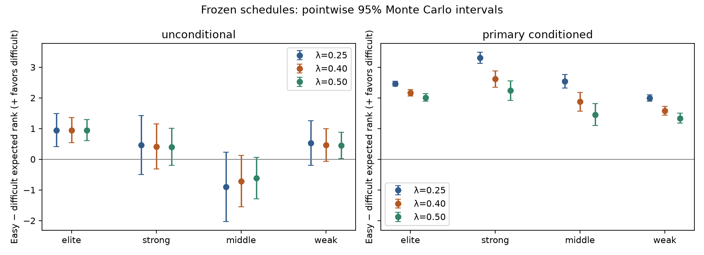

# λ=0.40 as a Quality of Results candidate

**Assessment:** λ=0.40 is a defensible candidate for a later methodology decision.
It preserves meaningful additional significance for winning and meaningful margin
evidence. The frozen elite/strong experiments identify no new systematic
easy-schedule concern relative to .25/.50. This does not establish schedule
equivalence, resolve the middle/weak limitations, or uniquely favor .40.
**No production methodology is selected or activated.**

This is actual λ=.40 inference, not interpolation: 3,600 frozen synthetic trials,
five season baselines, eight real-game score replacements, five removals and eight
issue 252 counterfactual states. Two additional validation solves check repetition
and input order. Historical .25/.50 results and all original artifacts are reused
unchanged. [Reproduction instructions](../../../docs/issue_269_lambda_040.md),
[provenance](provenance.json) and [manifest](manifest.json) retain the exact inputs,
sources, numerical settings, checkpoints, coverage and output hashes.

Numerical findings below describe model behavior. Records, schedules and margins
are observational descriptions; deciding how much those accomplishments deserve
is a normative judgment. Human polls, CFP choices and predictive agreement are not
correctness targets.

## A. Avoid artificially rewarding easier schedules

Positive Δ means the easier-schedule team has a **worse expected rank**, favoring
the difficult slate. Intervals are pointwise 95% Monte Carlo intervals for the
mean, not posterior credible intervals or equivalence tests. Exactly the frozen
500 unconditional, 200 primary-record-conditioned and 200 own-record-conditioned
control seeds per profile were used; no membership or outcome was redesigned.

| Profile | Unconditional .25 Δ [CI] | Unconditional .40 Δ [CI] | Unconditional .50 Δ [CI] |
| --- | --- | --- | --- |
| Elite | +0.948 [+0.410, +1.486] | +0.948 [+0.535, +1.361] | +0.948 [+0.600, +1.295] |
| Strong | +0.464 [-0.492, +1.419] | +0.418 [-0.312, +1.147] | +0.405 [-0.202, +1.011] |
| Middle | -0.903 [-2.032, +0.226] | -0.715 [-1.551, +0.122] | -0.615 [-1.294, +0.065] |
| Weak | +0.529 [-0.197, +1.255] | +0.466 [-0.068, +1.001] | +0.448 [+0.019, +0.876] |

At .40, the easier team receives the better expected rank in **29.2%, 38.4%,
48.4% and 36.8%** of elite/strong/middle/weak draws. Individual difference SDs are
**4.71, 8.32, 9.55 and 6.10 ranks**: an average preference does not guarantee an
individual ordering. Full percentiles and Wilson probability intervals are in
[schedule_summary.csv](schedule_summary.csv); every individual pair is retained.

The primary elite result retains difficult-schedule recognition. The strong mean
also favors difficulty but its interval permits an average easy advantage of .312
ranks; there is no frozen practical-equivalence threshold. The middle estimate still points toward
an easy advantage and permits one exceeding a rank place. Neither a smaller mean
nor an interval spanning zero is evidence of success by itself.

| Profile | Primary-record-conditioned .25 Δ [CI] | .40 Δ [CI] | .50 Δ [CI] |
| --- | --- | --- | --- |
| Elite | +2.465 [+2.384, +2.547] | +2.170 [+2.065, +2.274] | +2.014 [+1.896, +2.133] |
| Strong | +3.310 [+3.126, +3.494] | +2.616 [+2.351, +2.882] | +2.236 [+1.924, +2.549] |
| Middle | +2.544 [+2.324, +2.764] | +1.873 [+1.569, +2.178] | +1.457 [+1.103, +1.810] |
| Weak | +1.998 [+1.892, +2.103] | +1.576 [+1.433, +1.719] | +1.340 [+1.174, +1.507] |

All four conditioned .40 means favor difficult schedules, including elite and
strong. Relative to .25, the matched elite preference decreases by **.295 ranks
[−.326,−.266]**, and the strong preference by **.694 [−.780,−.608]**; .50 reduces
it further. This is a real change in recognition, not an automatic improvement
because it approaches zero. At .40 easy-arm outrank probabilities are **0%, 7.5%,
20% and 5.5%**. Individual conditioned difference SDs increase from .25 to .40
(**.588→.755, 1.329→1.916, 1.588→2.199, .760→1.034**), even as unconditional
spreads decrease. Greater within-record margin sensitivity is the tradeoff.

The unconditional question concerns scheduling before outcomes; the conditioned
question concerns the frozen approximately-expected records. They are not pooled.
Own-record controls and controls selected through the primary seeds remain separate.
Unconditional .40 same-schedule control SDs are **10.78/15.53/18.33/14.12**;
own-record control SDs are **2.05/4.97/6.17/6.25**, with all their mean intervals
spanning zero. The elite conditioned preference (2.17) is comparable to its own-record
control SD, rather than negligible against every control. Independent control
margins also make their spreads broader than matched primary margins; no control
quantity is subtracted as an estimated bias. The weak primary-seed control mean
is **−2.41 [−4.60,−.21]** despite identical schedules, while its own-record control
mean is **−.16 [−1.02,+.71]**. This continuing selected-sample/pointwise-interval
pattern cannot itself be an easy-schedule effect.

The weak profile retains the uncertainty reversal: under .40 its easy schedule has
unconditional mean posterior SD **0.91 ranks lower**, entropy **0.163 bits lower**,
and 80% width **2.30 positions smaller**. Elite/strong easy schedules instead have
higher SD by **0.96/1.14** ranks. These are continuing robustness concerns, not a
new elite scheduling failure or evidence that narrower distributions are better.
The [arm summaries](schedule_arms.csv) retain absolute uncertainties and intervals;
[matched candidate contrasts](schedule_candidate_contrasts.csv) use within-seed
differences rather than treating candidates as independent samples.

## B–C. Preserve winning significance and performance evidence

Outcome benefit is `E[rank at −3] − E[rank at +3]`; within-win benefit is
`E[rank at +10] − E[rank at +35]`. All values below are improvements in expected
rank. Each cell is **outcome / margin / their difference**.

| Frozen probe | λ=.25 | λ=.40 | λ=.50 |
| --- | --- | --- | --- |
| Alabama–Tennessee, 401856723 | 2.638 / .470 / 2.169 | 1.725 / .582 / 1.143 | 1.305 / .622 / .683 |
| Central Michigan–Miami (OH), 401866476 | 11.993 / 3.684 / 8.308 | 8.888 / 5.092 / 3.796 | 7.225 / 5.773 / 1.452 |
| Issue 252 approximately-even schedule | 8.402 / 1.686 / 6.716 | 6.467 / 2.516 / 3.951 | 5.362 / 3.007 / 2.355 |
| Issue 252 weaker-opponent schedule | 5.436 / 1.735 / 3.702 | 4.342 / 2.626 / 1.717 | 3.705 / 3.170 / .536 |

In all four frozen contexts, .40 gives crossing the outcome boundary materially
more importance than expanding an existing comfortable win, while the positive
within-win benefits retain margin information. It sacrifices some .25 outcome
credit and supplies more margin sensitivity; .50 goes further. These nonlinear
responses were solved directly. Four fixed contexts do not establish a universal
points-per-win exchange rate or isolate an intrinsic strength effect.

Single-game removals expose a consequential distinction. Positive changes mean
**worse after removing** the observation:

| Focal observation | .25 ΔE[rank] | .40 ΔE[rank] | .50 ΔE[rank] |
| --- | --- | --- | --- |
| Alabama–Tennessee, 401856723 | −2.204 | −1.814 | −1.607 |
| Oregon 84–0 Portland State, 401858455 | +3.094 | +4.330 | +5.007 |
| Michigan 6–13 Indiana, 401858496 | −1.711 | −.612 | +.026 |
| Memphis 41–34 East Carolina, 401862807 | +1.514 | +.155 | −.627 |
| Central Michigan–Miami (OH), 401866476 | −7.283 | −5.162 | −4.011 |

At .40 Michigan's competitive defeat still worsens its overall evaluation, but
less than at .25; it has not become equivalent to a victory. Memphis retains a
small positive total response to its win, whereas .50 evaluates it slightly
better without that game. Oregon's extreme FCS victory carries substantial
margin evidence, more than at .25. Whether that much blowout credit is desirable
is a real judgment to accept explicitly. These are overlapping whole-network
responses, not independent additive game contributions. Opponent and every other
FBS response, ordinal changes and uncertainty are retained in
[game_diagnostics.csv](game_diagnostics.csv) and
[network_responses.csv.gz](network_responses.csv.gz).

## D. Defensible evaluations of actual accomplishments

The population comparison covers all five original snapshots. Differences are
higher λ minus lower λ; the mean and maximum below use absolute expected-rank
differences. Entries/exits concern displayed ranks, not latent selection events.

| Snapshot | .25→.40 mean / max | .40→.50 mean / max | Largest .25→.40 change |
| --- | --- | --- | --- |
| 2025 pre-bowl | 1.820 / 10.654 | 1.011 / 5.768 | Arkansas improves 10.654 |
| 2025 final | 1.809 / 10.509 | 1.010 / 5.779 | Arkansas improves 10.509 |
| 2026 Week 2 | 2.414 / 5.560 | 1.464 / 3.472 | Kansas State improves 5.560 |
| 2026 Week 5 | 2.464 / 10.008 | 1.417 / 5.381 | Marshall worsens 10.008 |
| 2026 Week 9 | 2.096 / 9.262 | 1.184 / 5.179 | Stanford worsens 9.262 |

| Snapshot | Top 12 .25→.40: enter / exit | Top 12 .40→.50: enter / exit |
| --- | --- | --- |
| 2025 pre-bowl | Utah / BYU | Miami / Oklahoma |
| 2025 final | none | Vanderbilt / BYU |
| 2026 Week 2 | Penn State, Texas, Alabama / Ole Miss, North Carolina, Memphis | Texas A&M / Massachusetts |
| 2026 Week 5 | Ohio State / Iowa | none |
| 2026 Week 9 | Ole Miss / Wake Forest | none |

For Top 25, pre-bowl membership is unchanged. Final .40 adds Penn State in place
of TCU relative to .25; .50 then adds Missouri/South Florida and removes
Arizona/Virginia relative to .40. Week 2 .40 adds Ohio State/Oklahoma/Iowa and
removes Auburn/Oregon/Colorado; .50 then adds Kansas State/Mississippi State and
removes Ole Miss/North Carolina. Week 5 .40 adds Oklahoma State/Tennessee for
Cincinnati/Texas Tech; .50 then adds Houston/Virginia for Ole Miss/Oklahoma State.
Week 9 .40 adds Nebraska for Iowa, with no further .50 membership change.
Full Top 10 changes, Top 12/25 masses, ordinal movements, maximum changes and
uncertainty contrasts are in [population_comparisons.json](population_comparisons.json).

The [contender appendix](contenders.md) displays every team in the .25/.50 Top 18
union, covering the Top 12 neighborhood without choosing cases for favorable .40
results. [Rankings](rankings.csv) mark the full neighboring Top 25 union;
[actual game evidence](contender_games.csv.gz) accompanies it. All **70 original
snapshot-case observations** are retained at three weights in
[cases.csv.gz](cases.csv.gz).

### Kentucky versus LSU, Week 9

| Team | Record / average margin | .25 ordinal / mean / Top 12 mass | .40 | .50 |
| --- | --- | --- | --- | --- |
| Kentucky | 7–1 / +8.1 | 7 / 10.830 / .684 | 11 / 11.941 / .631 | 11 / 12.697 / .594 |
| LSU | 6–2 / +24.1 | 6 / 9.833 / .728 | 3 / 7.699 / .825 | 3 / 6.709 / .871 |

Kentucky has the additional victory and a one-point head-to-head win. Its frozen
common-reference schedule probability is .350 versus LSU's .378, both difficult
(lower means harder). Kentucky also won by one against South Carolina, by eight
against Oklahoma and by ten against Texas A&M, but lost to Alabama by 28. LSU
beat Clemson by 41, Texas A&M by 29, Mississippi State by 31 and Auburn by 21;
its losses were by eight to Ole Miss and one to Kentucky.

The .40 candidate widens LSU's expected-rank advantage from **1.00 to 4.24** and
retains Kentucky in the Top 12. Extra victories, schedule difficulty and the
head-to-head result support Kentucky's accomplishment claim; LSU's stronger
margin evidence supports the competing evaluation. .40 meaningfully adopts more
of that latter interpretation. The observed head-to-head win remains evidence,
not a constraint fixing the entire season ordering. Posterior SDs at .40 are
9.49 and 6.62; the displayed eight-position gap is not a statement of certainty.

### BYU versus Vanderbilt, 2025 final

| Team | Record / average margin | .25 ordinal / mean / Top 12 mass | .40 | .50 |
| --- | --- | --- | --- | --- |
| BYU | 12–2 / +12.3 | 12 / 14.908 / .464 | 12 / 16.390 / .387 | 13 / 17.299 / .341 |
| Vanderbilt | 10–3 / +15.6 | 15 / 18.628 / .324 | 13 / 17.399 / .350 | 12 / 16.768 / .364 |

.40 preserves BYU's ordering and displayed Top 12 place; .50 reverses them.
BYU's extra wins include close wins over Utah (+3), Arizona (+6), Colorado (+3)
and Georgia Tech (+4), alongside two Texas Tech losses by 22 and 27. Vanderbilt
faced a harder frozen reference slate (.462 versus .536), beat Tennessee by 21,
South Carolina by 24 and Kentucky by 28, and lost to Texas by three, Alabama by
16 and Iowa by seven. More record emphasis defends BYU; stronger schedule and
margin emphasis defends Vanderbilt. At .40 their expected ranks are only **1.01**
apart with SDs **9.44/9.90**. The .387/.350 latent masses do not make either team's
actual CFP selection more or less probable by those amounts. Pre-bowl is a
different observation: Vanderbilt is ahead at all three weights, and .40 already
moves BYU outside the displayed Top 12.

### UCLA, Georgia, Notre Dame and the boundary

Week 9 UCLA moves **3→7→8** across .25/.40/.50 even though its expected rank is
almost unchanged: **9.062→9.184→9.263**. Its .40 Top 12 mass is .755. This is
primarily crowding by improving rivals, not a collapse in UCLA's evaluation.
UCLA's 7–0 record and two-point Oregon victory compete with Notre Dame's 6–1
record, four-point BYU loss and wins by 51 over Stanford, 39 over Purdue and 52
over Rice. Notre Dame moves **8→6→5**, expected rank **10.876→8.750→7.723**.
Georgia moves **10→8→7**, with a three-point Alabama win, dominant Oklahoma and
Arkansas wins (+28 each), and a three-point Auburn loss. .40 thus retains strong
undefeated credit while allowing strong one-loss performances to pass UCLA.
Preferring UCLA's unbeaten record is a defensible competing priority.

At the Week 9 boundary, Ole Miss (5–2) passes Wake Forest (6–1) at .40, despite
both improving in expected rank. Their .40 means are **13.381/13.678**, and Top 12
masses **.587/.565**. Ole Miss's harder reference slate (.299 versus .460), LSU
win (+8), and Missouri/Vanderbilt wins (+28/+35) compete with an additional Wake
Forest victory, a 13-point Miami loss and a 54-point Stanford win. A .297 mean
gap should not be presented as a decisive accomplishment difference.

The Top 25 changes have the same substantive character. Week 9 Nebraska's
three-point losses to Indiana and Oregon accompany several convincing wins;
Iowa has one- and three-point wins over Michigan/Iowa State and losses by 17 to
Ohio State and three to Minnesota. Nebraska improves **25.28→20.53** while Iowa
barely improves **24.86→24.63**, producing a membership swap. In 2025 final,
Penn State's 7–6 season includes five losses by six or fewer and large early
wins; TCU's 9–4 includes several narrow wins and a 31-point BYU defeat. .40
admits Penn State over TCU. .50 goes further toward Missouri/South Florida's
performances over Arizona/Virginia's records. The complete dated evidence is
retained so these judgments can be challenged directly.

### Excellent records on easier slates

Navy's 2025 final 11–2 record yields ordinal ranks **41/46/51**, with expected
ranks **47.80/55.32/59.65**. One-point Temple/Army wins and a three-point Air Force
win compete with losses by 39 to Notre Dame and 14 to North Texas; its schedule
reference probability is .692. .40 gives more recognition to the poor/narrow
performances than .25 does, without denying the wins.

Week 9 UTSA is 7–1 on a .579 slate and exceeds its frozen expectation by about
1.95 wins, including a 23-point Tulane win. Yet wins by two over Rice and four
over Navy and a 24-point Texas loss accompany a +7.5 average margin. Its ordinal
ranks are **34/41/48**, Top 25 masses **.416/.298/.235**. Liberty's 6–1 record on
the easier .702 slate gives **48/47/46**: margin evidence improves its mean modestly,
but its one-point Gardner-Webb win is far below its frozen expected margin.
Liberty's .40 Top 25 mass is .265 and SD 22.84. Neither is promoted into a
displayed contender set merely by accumulating expected victories. These selected
examples support the absence of a new concern; they cannot prove causal schedule
neutrality. Retrospective 2026 expectations reuse game evidence and are not
independent forecasts.

## E. Preserve uncertainty and recognize nonlinear behavior

| Snapshot | Mean posterior SD .25 / .40 / .50 |
| --- | --- |
| 2025 pre-bowl | 15.02 / 14.19 / 13.70 |
| 2025 final | 14.56 / 13.76 / 13.29 |
| 2026 Week 2 | 35.38 / 34.75 / 34.29 |
| 2026 Week 5 | 25.95 / 24.85 / 24.15 |
| 2026 Week 9 | 19.67 / 18.63 / 18.00 |

Mean entropy and credible widths also decline with greater weight, but individual
uncertainties need not. Kentucky's SD increases from 9.11 to 9.49 at .40 while
LSU's falls from 8.50 to 6.62. Liberty's better expected rank coexists with a
slightly lower Top 12 mass as its posterior narrows. In the frozen weak cases,
Massachusetts is narrower than Stanford at the same 4–4 record (.40 SD
18.81 versus 23.67), and UTEP is much narrower than Purdue at 2–10 (5.55 versus
17.71). Their locations near bounded support differ; these observations do not
identify a mechanism or establish calibration.

There is no unexpected population-wide narrowing discontinuity at .40. Week 2
remains extremely uncertain even when displayed ordinal positions move sharply.
Five teams have .40 expected ranks slightly outside the .25/.50 range; the largest
departure is Georgia Southern in Week 2 (**.098 ranks**). Iowa's Week 5 departure
is **−.008** and is the only such expected-rank case in a neighboring Top 25 union.
Other uncertainty/top-mass departures are listed separately in
[nonmonotonic.csv](nonmonotonic.csv). Small nonlinearities are observed behavior,
not evidence of numerical failure or a reason to assume linear interpolation.

## Numerical validity, resources and limits

All new inference uses the original V1 likelihood, snapshot-specific priors, FCS
handling, full opponent networks and Performance prior stripping. All solves
converged with maximum 500 iterations, tolerance 1e-9 and damping .35. Complete
FBS/Context supports and normalization are checked for network solves; complete
focal PMFs are retained for every synthetic trial. Evidence fingerprints match
the frozen observations. Week 9 input reversal and an independent elite trial
repeat both reproduce **bit-identical PMFs**, including all Context marginals for
the network check. Existing endpoint/order gates remain authenticated. The core inference sources,
Python pin and dependency lock also match the original issue 252/261 executions
byte for byte; [source_compatibility.json](source_compatibility.json) records the audit.

The 18 required network solves used **540.4 summed solve seconds**, with **26–101
iterations**, largest terminal message change **9.91e-10**, and process high-water
RSS **1.25 GiB**. No resource bound was relaxed. The synthetic profiles used **4,032.7 summed inference seconds**, approximately
**16.7–17.2 minutes per concurrent profile invocation**, with **18–23 iterations**,
maximum terminal delta **9.99e-10** and at most **.43 GiB** process high-water RSS.
The four synthetic profiles ran concurrently with one BLAS/OMP thread each;
network/sensitivity stages and validation also ran concurrently, so summed times
are not elapsed task time. RSS includes previous cells in the process. Scientific
outputs use deterministic gzip; runtime measurements vary. Cached replay requires
matching identities and hashes and performs no historical neighboring inference.

Limits remain those of the frozen studies: model-based synthetic generation uses
the same likelihood as inference; disconnected stars omit real-network cycles;
profiles have different PMFs, boundaries and slates; pointwise intervals are not
multiplicity-adjusted and shared seeds induce dependence across profiles. Real
cases are selected descriptions, not randomized schedule experiments. Historical
2025 acquisition availability, the 2026 Week 2 FCS retrieval gap, prior/likelihood
misspecification and approximate loopy BP remain limitations. No attempt was made
to tune another weight or repair schedules to accommodate particular rankings.

## Final methodological answers

1. **Numerical and reproducibility requirements:** pass for the complete requested
   inventory, frozen memberships and original artifacts, including direct .40
   repeat/order checks.
2. **Identifiable new methodological problem:** none in this bounded evaluation.
   Middle-profile easy-schedule ambiguity, weak uncertainty reversal and strong
   extreme-margin influence remain concerns to acknowledge, not resolved defects.
3. **Desirable properties preserved:** opponent/schedule recognition, material
   special significance for winning, positive scoring-margin sensitivity and
   explicit uncertainty all remain present.
4. **Substantive tradeoffs:** .25 most protects additional wins and narrow-win
   records; .50 most recognizes strong margins/competitive losses and discounts
   unimpressive wins; .40 retains stronger winning emphasis than .50 while making
   consequential performance distinctions beyond .25. Kentucky/LSU, UCLA's rivals,
   BYU/Vanderbilt, Memphis and Oregon show concrete consequences.
5. **Defensible potential production candidate:** yes, provided those tradeoffs
   and continuing limits are accepted explicitly. This is an assessment of a
   candidate, not production adoption.
6. **Reason to prefer one:** the evidence supports conditional preferences, not a
   unique empirical winner. Greater priority to extra wins supports .25; greater
   priority to margins supports .50; wanting meaningful weight on both makes .40
   defensible. Merely falling between the neighbors earns no credit. The final
   weighting choice remains normative.
7. **Further research required before that decision:** no additional numerical
   tuning or ranking-driven probes are needed to choose among these three under
   the stated goals. A demand for causal schedule neutrality or uncertainty
   calibration beyond these frozen settings would require separate research.
   Those broader properties are not established here.
